# Panda Vision Grasp

A vision-based grasping project for the Franka Emika Panda arm, simulated in MuJoCo: a policy
learns to grasp an object from **camera pixels alone**, with no privileged object pose in its
observation. A separate project (and repo) from `go1_rl_walk`, `slam_sim`, `wam`, and
`barrett_wam` (sibling directories), following the same convention: each new kind of problem
gets its own repo, not a branch of an existing one.

<p align="center">
  
</p>

*Stage 1's verification sweep: each of the 7 arm joints driven to its own range limits and back
under the model's own (already-tuned) position actuators, then the gripper closing and opening.*

## Scoping decisions

- **Platform: the Franka Emika Panda** (`mujoco_menagerie`'s `franka_emika_panda` package),
  not the Barrett WAM again or a different arm -- chosen specifically *because* a ready-made,
  already-tuned MuJoCo model exists for it (vendored wholesale into `assets/`, see
  `assets/NOTICE.md`), unlike `barrett_wam`'s arm which had to be built from a raw URDF. That
  frees this project to spend its effort on the actual new problem (vision) instead of
  re-doing `barrett_wam`'s model-building work on different hardware.
- **Task: vision-based grasping from pixels**, not reach/track/grasp staged from scratch again
  -- `barrett_wam` already covered that staged arc on different hardware; the genuinely new
  capability here is replacing privileged ground-truth object pose with a camera observation,
  which every prior project in this environment has either used ground truth for (`barrett_wam`)
  or deferred entirely (`wam`'s own pixel-based-world-model track got as far as one-step/rollout
  prediction, never a working grasp/control policy from pixels).
- **Approach: end-to-end RL, pixels directly to actions**, not a classical pose-estimation step
  feeding the existing scripted/IK control stack. A bigger, more open-ended learning problem than
  a perception-only swap -- deliberately chosen over the smaller alternative (estimate pose from
  the image, reuse scripted control) to make the vision question itself the hard part being
  tested, not an isolated side-channel.
- **Simulator: MuJoCo**, reusing the same physics engine every sibling project already uses, via
  `go1_rl_walk/mpc`'s venv (same `mujoco>=3.1.0` dependency, no new venv needed).

## Staged plan

1. **Vendor the Panda model, verify it loads and actually moves under its own actuators --
   DONE.** `mujoco_menagerie`'s `franka_emika_panda` package is already a curated, ready-to-use
   MJCF model (position-controlled arm actuators, a tendon-coupled two-finger gripper actuator
   remapped to a 0-255 command range) -- copied wholesale into `assets/` rather than re-derived,
   since (unlike `barrett_wam`'s arm) there was no import problem to fix here.

   **Verified with real closed-loop physics stepping (`mj_step` under gravity), not just
   forward kinematics on a set `qpos`** -- each of the 7 arm joints commanded to its own
   `[low, high]` range and back to 0 one at a time (holding the others at their last commanded
   target), then the gripper closed (`ctrl=0`) and opened (`ctrl=255`, confirmed empirically:
   `ctrl=0` converges `finger_joint1` to 0/closed, `ctrl=255` converges it to 0.04/open).

   **Found a real, repeatable steady-state gravity sag, not hidden**: holding all 7 joints at a
   commanded target of 0 for 3s converges to `[0, 0.001, 0, -0.07, 0, 0.193, 0.001]`, not exactly
   0 -- joint6 in particular sags ~11 degrees under gravity at this pose. Not fixed here (no
   gravity-compensation feedforward added, unlike `barrett_wam`'s Stage 2): the end-to-end RL
   policy planned for later stages observes pixels and outputs actions through the same
   imperfect position-control loop, so it has every opportunity to learn around this bias as
   part of the task itself, the same way a real robot's controller imperfections are just part
   of what a learned policy has to work with -- revisit only if a later stage's results suggest
   this sag is actually a limiting factor, not before.

2. **Grasp scene + a scripted (privileged-state) reach/grasp/lift sanity check -- DONE.**
   Before spending any effort on the actual pixels-only learning problem, confirmed the scene
   itself (table height, object size, gripper geometry, joint reach) is physically solvable at
   all -- same discipline as `barrett_wam`'s own staged approach. This scripted baseline is
   **not** the project's deliverable (it uses privileged ground-truth object position), only a
   feasibility check and a reference number to compare the eventual vision policy against.

   `assets/grasp_scene.xml` adds a static table, a free-floating graspable object, and a fixed
   external `workspace_cam` (computed via a look-at from `(1.3, 0, 1.05)` toward the table
   center) -- the same view the eventual pixels-only policy will actually observe from. One
   small, documented modification to the vendored `panda.xml` (see `assets/NOTICE.md`): added a
   `gripper` site at the same local offset the upstream package's own MJX variant already uses,
   needed as an IK/grasp-point reference.

   **Three real bugs found and fixed, not glossed over**:
   - **Object spawned inside the table.** `table_top_z` was computed from `model.geom_pos`
     (the table-top geom's *local* offset inside its parent body, which is `(0,0,0)` here,
     since this scene nests the geom inside a positioned body rather than placing it directly
     in `worldbody` the way `barrett_wam`'s layout did) instead of `data.geom_xpos` (the
     resolved *world*-frame position) -- silently computing the body's own origin height
     instead of the table's actual top surface. The sphere spawned embedded 21cm deep inside
     the table block, and the contact solver's violent resolution of that overlap sent it
     sliding clear across the table at explosive speed (drift up to 20m, confirmed). Fixed by
     reading `data.geom_xpos` (post `mj_forward`) instead.
   - **Position-only IK's redundant-DOF drift, a new failure mode this project hadn't hit
     before.** Even after fixing the spawn bug, re-solving IK on a slowly-moving Cartesian
     target every single control step (the same pattern `barrett_wam`'s `run_phase` used
     successfully) let the arm's 4 redundant DOF drift through null space over hundreds of
     tiny re-solves, with nothing pulling them back -- confirmed directly: the forearm
     (`link3`) ended up pinned against the table, `qfrc_actuator` saturated at its torque limit
     fighting a real contact, even though every single per-step IK solve reported success
     (its convergence check is purely kinematic and has no notion of what the real,
     physically-driven arm can or can't do). A pure null-space bias term (pulling the
     redundant DOF toward the original posture) was tried first and made things worse, not
     better -- discrete joint-limit clipping breaks the clean orthogonality the math assumes,
     so a non-trivial bias weight just destabilized the primary-task convergence instead.
     **Fixed with a structurally different approach instead of a tuning fix**: solve IK
     *once* for the final descend target (warm-started from the already-validated pregrasp
     posture, not from scratch), then interpolate the commanded pose in *joint* space between
     the two solved endpoints -- no per-step re-solving, so there's nothing left to drift.
     Also found that orientation-score selection alone (picking whichever `best_oriented_ik`
     candidate faces most nearly downward, `barrett_wam`'s own criterion) wasn't sufficient by
     itself: the single best-scoring candidate for one specific table position still pinned a
     joint at its hard limit and, when warm-started down to the grasp height, drove the
     forearm into the table anyway. Fixed by folding that check directly into candidate
     selection: a candidate is rejected outright if warm-starting it down to the actual grasp
     height produces any arm/table contact, before orientation is used to rank the survivors.
   - **A sphere (tried first, same object choice as `barrett_wam` and for the same
     orientation-invariance reason) turned out not to work with this gripper.** It looked fine
     right after lifting but was found to slip free after roughly a second of an otherwise-
     completely-static hold -- gripper qpos collapsing from ~0.025 to ~0 and the object
     dropping back to the table -- a real geometric mismatch (pinching a smooth round object
     between two flat parallel pads is a classic non-form-closure grasp), not a tuning bug:
     higher friction wasn't the fix. The eval itself was missing this entirely at first too,
     since it only measured rise right after the lift motion completed with no further hold --
     fixed by adding a 2-second static `POST_LIFT_HOLD_SECONDS` before measuring success, which
     is what actually caught the slip. Switched the object to a small box instead (flat faces
     mate properly with the flat gripper pads), which brings an orientation requirement back
     in -- handled by computing the box's spawn yaw per trial (`object_yaw_for_gripper`) from
     the gripper's actual closing-axis direction at whichever posture `best_oriented_ik`
     happened to land on, rather than fixing one global orientation that would only sometimes
     line up.

   **Evaluated over 20 random table positions** (`eval_stage2_reach_grasp.py`), now including
   the 2-second post-lift static hold: **20/20 grasped** (object rises ~0.142-0.147m of a
   commanded 0.15m lift, settles within 6mm of its starting position) -- a clean, reliable
   baseline, genuinely stable under sustained holding, not just at the instant the lift motion
   finishes.

   <p align="center">
     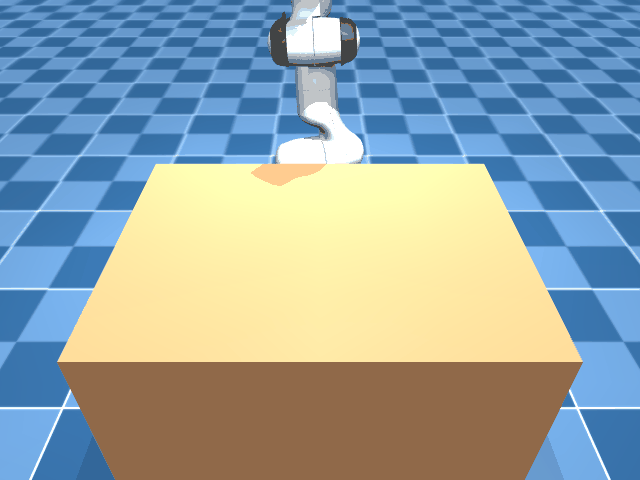
   </p>

   *Stage 2's demo (`demo_stage2_reach_grasp.py`, seed 0): rendered from the exact same fixed
   `workspace_cam` the eventual pixels-only policy will observe from, not a cosmetic orbiting
   camera -- this is the view the vision task actually has to solve from.*

3. **The actual vision Gym environment -- DONE (env verified, policy training not yet
   launched).** `grasp_env.py`'s `GraspPixelEnv`: a Gymnasium env whose observation is
   `{"image": 64x64 RGB from workspace_cam, "proprio": 15-dim arm joint pos/vel + gripper
   position}` -- no object position, no contact force, no privileged state of any kind reaches
   the policy. Action is 8-dim: a per-step delta on the 7 arm joint targets (bounded by
   `MAX_JOINT_RATE`) plus a direct gripper ctrl command, same bounded-step reasoning as
   `barrett_wam`'s residual design (keeps early random-policy exploration from immediately
   slamming the arm into the table or a joint limit). Reward is dense shaping (gripper-to-object
   distance, object height while lifted) plus a terminal success bonus, computed from
   ground-truth object state during training -- that's standard practice and doesn't leak into
   what the policy itself observes.

   **Scope decision, made explicitly rather than left implicit**: episodes start from a
   `best_oriented_ik`-computed pregrasp posture above the (randomized) object, not from the
   arm's arbitrary home pose -- same reasoning as `barrett_wam`'s own first RL stage, which only
   tackled its close phase rather than the whole pick. Cold-start RL on a long, multi-phase
   manipulation task is a well-documented hard problem, and `barrett_wam` hit it directly
   (repeated from-scratch failures even WITH privileged state) -- so the first attempt here
   narrows the learned portion to descend + grasp + lift, deferring "vision-guided reach from an
   arbitrary starting pose" to a later stage once this narrower problem is shown to work at all.

   **Verified the env itself before spending any training compute**, same discipline as
   `barrett_wam`'s own residual-RL premise check: replayed Stage 2's scripted
   descend/close/lift trajectory (converted into this env's own action space) through
   `GraspPixelEnv.step()` end-to-end. Result: `success=True`, matching Stage 2's own grasp
   criterion exactly, with a sane positive total episode reward (+20.8, dominated by the
   terminal bonus) -- confirming the env's physics, reward wiring, and action/observation
   plumbing are all correct before any policy has been trained on it.

4. **First PPO training run (`grasp01`) -- DONE, honest partial result: 0/20, real but
   insufficient learning.** `train.py` mirrors `barrett_wam`/`go1_rl_walk`'s own conventions
   (PPO + `SubprocVecEnv` + `VecMonitor` + `VecNormalize`, per-run `args.json`), with two
   changes for a `Dict{image, proprio}` observation: `"MultiInputPolicy"` instead of
   `"MlpPolicy"`, and `norm_obs_keys=["proprio"]` so `VecNormalize`'s running-mean/std
   normalization is applied only to proprioception -- normalizing raw image pixels too would
   feed the CNN extractor's built-in `/255` assumption the wrong distribution entirely.

   **Found and fixed a rendering-speed bug before launching any real training budget.**
   Benchmarked raw env throughput first (same "verify premise" discipline as
   `barrett_wam`'s residual-RL check): only ~46 renders/sec no matter the resolution tried
   (32-64px) or how many parallel envs were used (8 or 14 gave the *same* total throughput,
   not more -- a shared-GPU-context bottleneck, not a CPU one, confirmed via a single-process
   render-loop benchmark landing at the identical number). Traced to shadow-map rendering
   specifically (an extra render pass MuJoCo does for cast shadows): disabling it
   (`model.light_castshadow[:] = 0` in `GraspPixelEnv.__init__`) gave a confirmed **~13x
   speedup** (46 -> 630 renders/sec) -- a policy that only ever sees pixels has no need to
   interpret shadows anyway. Also fixed a crash found via a short smoke-training run (the
   actual "verify before scaling" check): `best_oriented_ik` occasionally finds no valid
   candidate for an unlucky random table position -- never hit in Stage 2's fixed 20-seed
   sweep, but real across training's much wider resampling (confirmed: it crashed a
   `SubprocVecEnv` worker on exactly this). Fixed by resampling the object position and
   retrying instead of letting one unlucky position crash an entire run.

   **Result** (1M timesteps, 8 parallel envs, ~430->270 fps as other load on the machine
   varied): episode reward climbed from the random-policy baseline (~-20 to -27) to **-12.7**
   over training -- a genuine, large improvement, not noise. `eval_policy.py` (same
   `random_table_xy` seed convention as `eval_stage2_reach_grasp.py`, so the two numbers are
   directly comparable): **0/20** succeeded. Rendering a held-out rollout showed why: the
   policy reliably learned to descend the arm down to table height near the object (not
   flailing randomly), but doesn't reliably center the gripper on it or time the close/lift
   -- it drifts past the object rather than grasping it. The same shape of result
   `barrett_wam` hit on its own first RL attempts (real, partial learning, not yet enough to
   succeed), on a problem that's strictly harder here: full reach+grasp+lift from raw pixels,
   cold-start, no privileged-state residual baseline to correct like `barrett_wam` eventually
   used. `barrett_wam`'s own directly analogous finding ("more data and time: 2/20 -> 4/20")
   was resolved by scaling up budget before any bigger redesign was needed -- tried next here
   too, see below.

   <p align="center">
     
   </p>
   <p align="center"><sub><code>grasp01</code>, seed 0 -- descends near the object but never centers/times the grasp.</sub></p>

5. **Scaled up 4x (`grasp02`, resumed from `grasp01`'s checkpoint, +3M timesteps = 4M total)
   -- negative result: more budget alone did NOT help here, unlike `barrett_wam`'s analogous
   case.** Same training recipe, no reward/hyperparameter changes. Result: **still 0/20**,
   training reward actually *regressed* partway through (climbed to -9.4 around the 1.5M-step
   mark, then drifted down to -12 by the end) rather than continuing to improve or even
   plateauing cleanly.

   **Diagnosed, not just reported as a flat "didn't work"**: the policy's action-distribution
   `std` collapsed hard and fast throughout this run (0.43 -> 0.06), while `approx_kl` stayed
   persistently far above PPO's normal healthy range (0.8-1.6, vs. a typical 0.01-0.05) for
   the entire 3M timesteps -- a small std mechanically inflates measured KL for the same
   underlying policy shift, which is consistent with premature exploration collapse: the
   policy became highly confident in a specific behavior (descend-but-don't-center) very
   early and stopped exploring away from it, rather than genuinely converging on a good one.
   `ent_coef=0.0` (this project's and `barrett_wam`'s shared convention, chosen there
   specifically because nonzero `ent_coef` risked a policy-std *blowup* on that lower-dimensional
   MLP policy) looks like the wrong default for this much higher-dimensional CNN-based policy
   on a harder task -- the two projects' policies apparently sit on opposite sides of the same
   knob. **Next experiment, not yet tried**: a small nonzero `ent_coef` (e.g. 0.01) to keep
   exploration alive longer, rather than further scaling the same recipe that already showed
   it won't self-correct.

   <p align="center">
     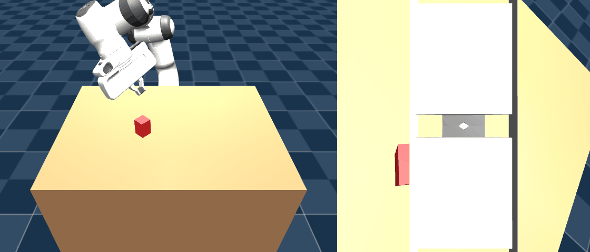
   </p>
   <p align="center"><sub><code>grasp02</code>, seed 0 -- exploration collapse, locked onto the same incomplete behavior.</sub></p>

6. **`ent_coef=0.01` (`grasp03`, fresh 1M-step run, not resumed -- resuming from `grasp02`
   would have carried forward its already-collapsed std) -- the diagnosed mechanism was fixed,
   but that wasn't sufficient to solve the task.** `std` held steady around 1.2-1.3 for the
   entire run (no collapse), and `approx_kl` stayed in a healthy range (well under 0.1 for most
   of training, only trivially near-zero at the very end as the linear LR schedule decayed to
   ~0). So the fix did exactly what it was diagnosed to do. Result: still **0/20**.

   The failure mode changed shape, though, which matters: `rise` across all 20 eval trials sat
   at essentially 0 (~-0.01m, noise-level settling) instead of grasp01/02's more erratic
   values. The policy isn't attempting a descend-grasp-lift sequence at all -- it's staying
   near its start state rather than drifting past the object or flailing. That's consistent
   with a different, likely deeper problem than exploration collapse: the task is thrown at
   full difficulty from step 0 (`random_table_xy` samples the entire table range on every
   single episode, from the very first one), with reward signal that's mostly a sparse +20
   terminal bonus plus small dense shaping -- there may simply not be enough early reward
   gradient for PPO to discover a multi-phase motor skill cold, across every object position
   at once, within this budget.

   **Lesson**: exploration collapse and insufficient task scaffolding are separate problems
   that can both be present -- fixing one (the collapse) is necessary but was not alone
   sufficient here. **Next experiment, not yet tried**: a position curriculum -- start
   `reset()` with a fixed or narrow object-position range, widen `TABLE_XY_RANGE` once reward
   crosses a threshold, so the policy can lock in a working grasp motion before having to
   generalize it across the full table.

   <p align="center">
     
   </p>
   <p align="center"><sub><code>grasp03</code>, seed 0 -- collapse fixed, but never attempts a grasp at all.</sub></p>

7. **Position curriculum (`grasp04`, fresh 1M-step run, `ent_coef=0.01` kept + a
   `CurriculumCallback` widening `TABLE_XY_RANGE`'s sampled scale 0.15 -> 0.4 -> 0.7 -> 1.0
   whenever rolling success rate over the last 20+ episodes clears 30%) -- the curriculum
   mechanism itself verified correct (confirmed via a smoke test forcing `threshold=0.0`,
   which advanced through all 4 stages as expected), but it never advanced a single stage
   during the real run: success rate never cleared 30% even at the easiest, narrowest object
   range. Still **0/20** -- both on the standard full-range eval (expected, since it never
   trained past the narrow stage) and, more tellingly, on a second eval run at the exact
   narrow scale (0.15) it actually trained on the whole time. That second number rules out
   "learned narrow, failed to generalize wide" -- the policy never learned the core
   descend-close-lift skill at all, even at the easiest difficulty.

   That said, this run is qualitatively different from grasp03: `ep_rew_mean` reached -8.59
   (the best of any run so far), and eval `drift` values are now consistently nonzero
   (0.03-0.31m, vs. grasp03's mostly-exact-zero) -- the arm is reaching in and contacting/
   pushing the object, not just sitting idle. So the distance-minimization part of the
   behavior clearly improved; it's specifically the precise "close the gripper at the right
   moment while in contact, then lift without losing it" sequence that's never being
   discovered.

   **Lesson: the bottleneck isn't task-difficulty breadth (what this curriculum targeted) --
   it's the fine-grained grasp-closing maneuver itself being too hard to stumble into from
   sparse reward + pure exploration, within this budget, cold-start.** Four attempts
   (`grasp01`-`grasp04`) have each correctly diagnosed and fixed a real, distinct problem
   (partial learning -> exploration collapse -> task scaffolding) without producing a single
   success -- strong evidence the remaining gap is structural, not a tunable hyperparameter.
   **Next experiment, not yet tried**: stop iterating on pure cold-start RL hyperparameters:
   warm-start the policy from Stage 2's already-working scripted trajectory (behavior cloning
   pretraining, or a residual-RL formulation on top of it), the same fix `barrett_wam` used
   for its own analogous cold-start RL difficulty -- let RL correct/adapt an already-working
   grasp motion from pixels, rather than discover the whole thing from scratch.

8. **Behavior cloning + PPO fine-tuning (`bc01` then `grasp05`) -- DONE, a genuinely new
   failure mode identified: the warm-start worked, the fine-tuning erased it.**
   `collect_demos.py` replayed Stage 2's scripted controller through `GraspPixelEnv`'s exact
   observation/action pipeline (200/200 scripted successes, full object-position range, not the
   narrow curriculum), producing 24,000 (image, proprio, action) transitions. `train_bc.py`
   supervised the same PPO policy architecture's action-mean against those demonstrations via
   plain MSE (no environment interaction) -- loss dropped cleanly from 0.09 to 0.002 over 20
   epochs. `bc01` alone: still 0/20, but the best result of any run -- small positive `rise`
   on several trials, much better rewards, and (measured directly) a per-step joint-delta
   magnitude of 0.0088 rad, matching the scripted controller's own 0.0119 rad pace almost
   exactly. BC genuinely learned the gentle, precise approach.

   <p align="center">
     
   </p>
   <p align="center"><sub><code>bc01</code>, seed 0 -- the gentle, correctly-timed approach BC learned from the demos.</sub></p>

   `grasp05` then fine-tuned that checkpoint with PPO (1M steps, `ent_coef=0.01`, same
   VecNormalize stats carried over) -- still 0/20, but **worse** than `bc01` alone, not better.
   Measured the same per-step joint-delta metric: fine-tuning pushed it from 0.0088 to 0.116
   rad, a 13x jump landing back in the same near-saturated regime `grasp04`'s failure GIF
   shows. **Root cause, not just correlation**: nothing in the reward penalizes how fast the
   arm approaches -- the action-magnitude term (`W_ACTION=0.001`) is deliberately tiny (same
   reward-hacking-avoidance choice as the distance term), and `gamma=0.98` discounting rewards
   reaching low distance *sooner* rather than carefully. PPO fine-tuning found it more
   rewarding to rush toward the object and knock it around than to preserve BC's careful,
   slow alignment -- it didn't correct BC's small residual errors (the intended use of RL
   fine-tuning on a good init), it overwrote the whole behavior.

   **Lesson: a warm-start only survives RL fine-tuning if the reward doesn't actively reward
   abandoning it.** The missing piece isn't exploration, scaffolding, or initialization
   anymore -- it's that nothing in `GraspPixelEnv`'s reward distinguishes a careful approach
   from a reckless one. **Next experiment, not yet tried**: add an approach-speed penalty
   (e.g. an action-magnitude cost that scales up specifically when `dist` is small, rather
   than a uniform one that would also slow down the reach phase), and/or lower
   `MAX_JOINT_RATE` itself so fast, careless motion isn't available to the policy at all.

9. **Approach-speed penalty (`grasp06`, PPO fine-tune from `bc01` again, with a
   proximity-gated `-W_APPROACH_SPEED * proximity * ||action||` term added to the reward) --
   DONE, mechanism confirmed correctly implemented but weighted far too weakly to matter.**
   Kept `MAX_JOINT_RATE` unchanged deliberately (lowering it would have silently rescaled
   `bc01`'s already-correct, validated action calibration -- its raw outputs were learned
   against the current rate constant). Premise-checked before training: replaying the scripted
   trajectory still gives `success=True`, reward 20.94 (vs. ~20.8 pre-change) -- the new term
   barely dents a genuinely careful trajectory, as intended.

   Result: still **0/20**, and the fix didn't actually change behavior -- measured directly,
   action magnitude at each episode's closest approach to the object was 0.1147 rad for
   `grasp06` vs. 0.1097 for `grasp05`, i.e. no improvement (if anything, slightly worse).
   **Root cause, found by breaking the reward into its components over a real rollout**: the
   penalty activates correctly, but its total contribution over an episode (`-0.33`) is
   dwarfed by the distance term's (`-20.0`) by roughly 60x -- the gripper is only within
   `PROXIMITY_RADIUS` for a handful of the 120 steps, and even there `W_APPROACH_SPEED=0.1`
   produces a per-step penalty of ~0.02-0.03, far too small to compete against an episode-long
   incentive to approach fast.

   <p align="center">
      
   </p>
   <p align="center"><sub><code>grasp05</code> (left) and <code>grasp06</code> (right), seed 0 -- fine-tuning overwrote <code>bc01</code>'s careful approach; the proximity penalty didn't change that.</sub></p>

   **Lesson: a proximity-gated penalty applied with the same weight scale as the always-on
   distance term is automatically dominated by it, roughly in proportion to how much of the
   episode each one is active for.** A fix needs a substantially larger weight (not the same
   order of magnitude as `W_DIST`), or a different mechanism that doesn't have to outweigh an
   accumulated 120-step term from a handful of steps near contact.

   **Before spending training compute on a re-weighted guess, swept it properly instead of
   just multiplying by 60x.** That single-episode 60x ratio turned out not to generalize: it
   depends heavily on how long a rollout spends inside `PROXIMITY_RADIUS`, which differs a lot
   between a *successful* trajectory (long dwell -- descend, close, hold, lift all happen
   close to the object) and a *failed* one (barely gets close at all). Swept
   `W_APPROACH_SPEED` in `{0.1, 0.3, 0.4, 0.5, 1.0, 2.0, 3.0, 6.0}` against **both** the
   scripted trajectory (10 seeds -- must stay successful, reward shouldn't move far from its
   ~20.8 baseline) and `grasp06`'s own real rollout (10 seeds -- want its approach-speed total
   to become comparable to its distance total, not stay negligible). The naive `W=6.0` does
   blow up the fast policy's penalty, but it blows up the scripted trajectory's just as much
   (reward -11.8, down from +21.2, despite still succeeding) -- confirming the 60x ratio was
   an artifact of comparing a failed episode's short dwell time against an assumed-equivalent
   successful one. **`W=0.5`** is the actual balance point: scripted stays 10/10 at
   reward~19.1 (barely down from ~20.8), while `grasp06`'s approach-speed total (-14.6) is now
   the same order of magnitude as its distance total (-12.4) instead of ~0.33 vs -20 -- a real
   competing incentive against rushing, without wrecking the careful baseline it has to coexist
   with. Set `W_APPROACH_SPEED = 0.5` in `grasp_env.py` and launched `grasp07` (same recipe as
   `grasp05`/`grasp06`: PPO fine-tune from `bc01`, `ent_coef=0.01`, 1M steps).

   <p align="center">
     
   </p>

   **What the failure actually looks like** (`grasp04`, seed 0; left panel is `workspace_cam`,
   the view the policy itself sees -- right panel is `wrist_cam`, an eye-in-hand camera added
   later purely for visualization, never part of the policy's actual observation): the arm
   descends and makes contact with the object -- it clearly isn't flailing or idle -- but
   drifts it sideways (`drift=0.106m`) rather than centering, closing, and lifting. This is
   representative of all four runs' shared shape: real, visible progress on
   reach-and-approach, with the precise close-then-lift sequence never discovered.

   | Run | Change tested | Result | Root cause identified |
   |---|---|---|---|
   | `grasp01` | First training, 1M steps | 0/20, reward -12.7 (up from ~-24 random) | Genuine partial learning, not yet enough -- descends near the object but doesn't center/time the grasp |
   | `grasp02` | Scaled to 4M steps (same recipe) | 0/20, reward regressed to -12 | Exploration collapse: action-std fell 0.43->0.06 while `approx_kl` stayed abnormally high (0.8-1.6) the whole run -- policy locked onto a bad behavior early, `ent_coef=0.0` (right for `barrett_wam`'s MLP, wrong for this CNN policy) let it happen |
   | `grasp03` | `ent_coef=0.01` | 0/20, reward -8.59 best segment, but `rise`~0 every trial | Collapse fixed (`std` held ~1.2-1.3) but policy never attempts a grasp at all -- full-difficulty random positions from step 0 left too little early reward gradient |
   | `grasp04` | Position curriculum (0.15->1.0 scale) on top of `ent_coef=0.01` | 0/20 at full range AND at the narrow scale actually trained on | Not a generalization gap -- the core descend-close-lift skill was never learned even at the easiest difficulty; the grasp-closing maneuver itself is the bottleneck, not task-difficulty breadth |
   | `bc01` | Behavior cloning on Stage 2's scripted controller (200/200 demo episodes, no RL at all) | 0/20, but qualitatively the best result so far: several trials showed small positive `rise` (up to 0.0115m, vs. every RL run's flat zero/negative), rewards mostly -2 to -14 | Classic BC compounding-error: imitates the demonstrator well locally but never saw how to recover from small deviations, so drifts off-distribution before completing the sequence |
   | `grasp05` | PPO fine-tuning (1M steps, `ent_coef=0.01`) on top of `bc01`'s checkpoint | 0/20, **worse** than `bc01` alone (rewards mostly -5 to -25) | Fine-tuning didn't correct BC's small errors -- it overwrote the whole gentle approach. Measured directly: `bc01`'s mean per-step joint delta is 0.0088 rad, matching the scripted controller's own pace (0.0119 rad); after fine-tuning it's 0.116 rad, a 13x jump back into the same near-rate-cap regime `grasp04` shows in the GIF above. Nothing in the reward penalizes approach speed, and `gamma=0.98` discounting rewards reaching low distance *sooner* -- PPO found it more rewarding to rush in and knock the object around than to preserve BC's careful alignment |
   | `grasp06` | Proximity-gated approach-speed penalty added to the reward, PPO fine-tune from `bc01` again | 0/20, action magnitude at closest approach unchanged (0.1147 vs `grasp05`'s 0.1097 rad) | Penalty correctly wired (premise check: scripted trajectory reward barely moves, 20.94 vs ~20.8) but its accumulated magnitude over an episode (-0.33) is ~60x smaller than the distance term's (-20.0) -- numerically negligible, not a logic error |
   | `grasp07` | Same as `grasp06` but `W_APPROACH_SPEED` raised 0.1->0.5 (swept and verified, not a naive 60x guess), PPO fine-tune from `bc01` again | 0/20, `drift`~0.0000m (vs `grasp04`/`05`/`06`'s 0.03-0.3m) | New failure mode: the penalty didn't teach a careful approach, it taught retreat. `dist` briefly tightens to 0.10m by step 10-20, then the arm backs off to 0.69m by episode end while action magnitude stays high (mean 1.37) -- cheaper to leave `PROXIMITY_RADIUS` than pay the approach-speed cost, since this policy was never on a path to the terminal bonus anyway |
   | `grasp08` | Same as `grasp07`, plus a new `W_SMOOTH * ||a_t - a_t-1||^2` action-rate penalty (see below) | 0/20, same retreat pattern as `grasp07` (`dist` never drops below its 0.157m start, climbs to 0.27-0.34m); oscillation somewhat reduced (raw smoothness total 168 vs `grasp01`'s 1675) but swamped by the same avoidance behavior | Confirms the failure is the proximity-gated penalty's design, not oscillation -- adding the smoothness fix on top didn't change the core problem |
   | `bc02` | One DAgger round on `bc01`: relabeled 200 `bc01`-driven rollouts with fresh expert corrections, merged with the original 24k demos (48k total), retrained from scratch | 0/20, mean reward WORSE than `bc01` (-18.2 vs -8.8), but best trial's `rise` 2.4x higher (0.0282m vs 0.0115m) with visually confirmed correct centering at the close phase | Fixed the targeted compounding-drift/alignment problem (confirmed via wrist-cam frames) but the correction labels are inherently noisier/larger than the original smooth demos, teaching a noisier overall policy (sign-flip rate 0.56 vs `bc01`'s 0.02) -- net regression on average despite fixing the specific failure mode |
   | `bc03` | Wrist camera (`wrist_cam`) promoted to a real policy input alongside `workspace_cam`; fresh demo collection + plain BC, no DAgger | 0/20, but best trial `rise=0.0885m` (3x `bc02`'s best), object genuinely grasped and held through the whole lift -- failed only on `drift=0.2444m` (lift-phase lateral precision, not alignment) | Closest result to success in the whole project: the alignment/grasping problem blocking every prior attempt is essentially solved for this case; the remaining gap narrowed to lift-phase lateral drift |
   | `bc04` | DAgger round 2 (on `bc03` this time, dual-camera), with `CORRECTION_CAP=0.15` added to avoid `bc02`'s label-noise regression -- merged with the original 24k `bc03` demos (48k total), retrained from scratch | 0/20, but a BROAD improvement over `bc03`, not one lucky trial: mean reward -8.55 vs -9.65, mean `rise` 0.0023 vs 0.00095, 5/20 trials with positive `rise` vs 2/20, max `drift` 0.149m vs 0.395m | Confirmed via per-step trace that the lift-phase drift is the same systematic, one-directional per-step bias as before (present from the moment the gripper closes, not a lift-kinematics artifact), just ~3-4x smaller in magnitude after one DAgger round -- matches DAgger's known iterative-convergence behavior, not a one-shot fix. `CORRECTION_CAP` worked: action-noise diagnostic stayed close to smooth-demo scale (mean\|action\| 0.038, vs `bc01`'s 0.031 and `bc02`'s blown-up 0.226), avoiding `bc02`'s regression. New finding exposed now that drift is smaller: on the best trial (seed 18) the grasp itself is rock-solid (object-gripper offset ~2mm, constant, through the whole lift) but `rise` plateaus at 0.068m and never reaches the 0.09m threshold -- a second, previously-masked shortfall (insufficient lift height, not just drift) |
   | `bc05_chunked` | Action chunking instead of per-step DAgger: standalone CNN+MLP regressor predicts a block of 10 future actions from one observation (`train_bc_chunked.py`), executed open-loop, re-planning every 10 steps instead of every step -- same clean 24k `bc03` demos, no DAgger | 0/20, WORSE on average than both `bc03` and `bc04` (mean reward -19.32 vs -9.65/-8.55) despite comparable mean `drift` (0.036, in between `bc03`/`bc04`'s) -- the worse mean comes from a heavy bad tail (12/20 trials below -20 reward, vs 0/20 for `bc03`/`bc04`) | New, chunking-specific failure mode: when a 10-step chunk's assumption breaks mid-execution (grasp not fully secure, object slips), the policy can't react until the chunk ends -- confirmed by trace (seed 0): object flung from the grip around step 80, policy keeps executing the committed lift+hold chunk as if still holding it, then the following re-observation is wildly out-of-distribution and cascades into the arm flying to `grip_xy` near the robot base by episode end (`dist` growing to 0.36m). On the best trial (seed 8) chunking showed something per-step BC never did: `drift` SHRINKING smoothly from 0.057m back to 0.007m over the back half of the episode, a genuinely self-correcting trajectory -- but `rise` still capped at 0.0396m, similar to `bc04`, not better |
   | `bc05_chunked --adaptive` / `bc06_chunked` | Proprio-keyed re-planning (commit only 1 step once the gripper reads closed) tested on `bc05_chunked`'s existing checkpoint, then on `bc06_chunked`, a retrain with randomized (not fixed-stride) chunk starts meant to make the model queryable off-grid | Both much worse, not better: `bc05_chunked --adaptive` mean reward -49.6 (vs its own fixed-cadence -19.3); `bc06_chunked` collapsed even at ITS OWN fixed cadence (mean reward -54.2, `rise` stuck at reset value and `drift=0.0000` in all 20 trials -- never meaningfully touches the object) | `bc05_chunked --adaptive` confirmed the model was only ever trained to be queried at fixed multiples of 10 -- forcing an off-grid query is a context it never saw, not just a harder one. The random-start retrain meant to fix that (`bc06_chunked`) itself failed to learn a usable policy at all (likely: the same ~2,400 training chunks spread over ~111 possible start positions per episode is too sparse to fit, vs. 12 well-sampled fixed positions) -- the proprio-keyed re-planning idea remains untested, not refuted; testing it properly needs either more demo data or a smarter (not uniform) random-start sampling scheme |
   | `bc06` (note: unrelated to `bc06_chunked` above) | DAgger round 3 -- NOTE run-name collision in naming only, not data: `bc06` is the 2nd per-step DAgger iteration (on `bc04`'s own rollouts, same `CORRECTION_CAP=0.15`), merged CUMULATIVELY with all prior rounds (`demos_dagger3.npz` 48k + `dagger04.npz` 24k = 72k total, proper DAgger convention of keeping every round, not just the latest) | 0/20, but the best result in the whole project: mean reward -7.99 (best yet), mean `rise` 0.0253 (11x `bc04`'s), 7/20 trials with positive `rise`, 3/20 trials EXCEEDING the 0.09m rise threshold outright, 14/20 under the 0.04m drift threshold. Best trial (seed 12) crosses the rise threshold comfortably by step 85 and reaches `rise=0.1158m` by episode end, failing ONLY on `drift=0.0515m` -- just 1.3x over the limit | Confirmed via trace: the SAME systematic one-directional drift bias as every prior round, continuing to shrink with each DAgger iteration (this round's worst-case drift is well below `bc04`'s). Action-noise diagnostic confirms the capped-correction discipline held through a 2nd cumulative round too (mean\|action\| 0.041, in line with `bc04`'s 0.038, nowhere near `bc02`'s uncapped 0.226). This is the first run where a single trial is close enough that one more DAgger round looks genuinely likely to cross the finish line |
   | `bc07` | DAgger round 4 (3rd per-step iteration, on `bc06`'s own rollouts, same `CORRECTION_CAP=0.15`), merged cumulatively with every prior round (`demos_dagger4.npz` 72k + `dagger05.npz` 24k = 96k total) -- launched directly off the user's visual observation that `bc06`'s gallery GIFs show the gripper closing near the TOP tip of the cube rather than centered, prompting a quantitative check (see below) before this round even finished training | 0/20, mixed vs `bc06`: mean reward WORSE (-9.02 vs -7.99) and the best-rise trials now carry MORE drift (up to 0.098m vs `bc06`'s best 0.052m), but 10/20 trials now get positive `rise` (vs 7/20) and the action-noise diagnostic, while still far from `bc02`'s blown-up regime, ticked up again (mean\|action\| 0.052, vs `bc04`'s 0.038 and `bc06`'s 0.041 -- a 3-round upward trend worth watching) | **The real finding is a newly-quantified vertical grasp-height bug, not this round's net result.** Measured the vertical offset between the gripper site and the object's center at the moment the gripper finishes closing (stabilized, 15 steps after first closing below 75%): the scripted expert grasps almost perfectly centered (mean offset 0.0003m across 20 episodes) but `bc04` and `bc06` both grasp ~0.049m high -- most of the way from the cube's center (half-height 0.03m) past its top edge -- confirmed visually (`media/grasp_height_comparison.png`, expert vs `bc06` wrist-cam at the close moment). This bias is INVARIANT across two full cumulative DAgger rounds (`bc04`: 0.0488m, `bc06`: 0.0489m, same to 3 decimal places) -- it long predates `bc06` and was being completely masked by the drift-focused analysis, since many of its worst cases (offset >0.05m) simply never lift the object at all (`rise` stuck at the reset baseline), trivially producing near-zero `drift` and hiding the real cause as "no grasp" rather than "bad grasp." `bc07` is the first round to visibly move this number (0.033m, down ~1/3), which is why more trials now attempt a lift at all -- but the same correction signal that's fixing vertical placement is simultaneously getting noisier overall (the mean\|action\| creep above), which is the most likely explanation for the worse drift on this round's successful lifts. Since the expert itself is dead-center, this is purely a policy-learned bias, not a flawed label -- plausibly a depth/scale misjudgment from the camera views rather than a label-noise problem, which per-step DAgger's correction signal only partially addresses |
   | `bc08` | Auxiliary z-error loss (`train_bc_auxz.py`): a small head on the BC policy's shared actor features predicts the FK-derived vertical grasp-height offset (a scene constant, so no privileged per-episode labels needed), trained jointly with the usual action MSE -- same `bc06` 72k dataset, no new DAgger data, to isolate this one change. First motivated by a depth-parallax probe (below) confirming `wrist_cam`'s apparent object size is a strong, monotonic depth cue (361px at correct height down to 28-75px at 3-8cm too high) while `workspace_cam` carries ~none (flat ~1215px throughout) | 0/20, best mean reward in the project (-7.22, vs `bc06`'s -7.99) and the first round-over-round DROP in action noise (mean\|action\| 0.026, vs `bc06`'s 0.041/`bc07`'s 0.052) -- but the targeted bug did NOT improve: mean vertical offset 0.056m, slightly WORSE than `bc06`'s 0.049m, with fewer trials even attempting a lift (4/20 positive `rise` vs `bc06`'s 7/20) | Auxiliary MSE converged cleanly in training (1.0 -> 0.0034 normalized over 20 epochs) -- the shared trunk CAN represent this quantity precisely from the demo distribution -- but that representation didn't translate into better height-targeting behavior at rollout. A real auxiliary-task pitfall: the trunk can satisfy an auxiliary loss using features the action head's own downstream layers never end up relying on, especially across the open-loop-training / closed-loop-rollout distribution shift every BC method here faces. The best-mean-reward result looks like a side effect of a smoother, lower-magnitude policy from the extra regularizing pressure, not of fixing the specific bug it targeted |
   | `bc13` | DAgger round 5 (4th per-step iteration, on `bc07`'s own rollouts, same `CORRECTION_CAP=0.15`, no auxiliary loss), merged cumulatively with every prior round (`demos_dagger5.npz` 96k + `dagger06.npz` 24k = 120k total) -- user: "go for the DAgger round 5" | **1/20 full success (seed 10) -- the first anywhere in this project's history.** Every metric improved at once: mean reward -5.03 (best yet, vs `bc07`'s -9.02), 14/20 positive-rise (vs `bc07`'s 10/20), z-offset 0.0195m (best yet, vs `bc07`'s 0.033m), yaw align err 4.01/18.07deg (best mean in the project), mean\|action\| 0.0295 (reversing the 3-round upward creep) | Confirms plain per-step DAgger, iterated a 5th time on the previous round's own rollouts, is the one lever in this project with real multi-round compounding evidence -- unlike every auxiliary-loss variant (items 21-23), which plateaued or regressed on the very first try. No sign yet that this lever has stopped working |

   **Every attempt's rollout GIF is embedded inline above, next to the item that explains it**
   (not grouped into one gallery at the end) -- each panel pair is `workspace_cam` (left) and
   `wrist_cam` (right, an eye-in-hand camera -- see NOTICE.md). For `grasp01`-`08` and
   `bc01`/`bc02` the right panel is visualization only, added after the fact; neither camera's
   content changes those checkpoints' behavior. From `bc03` onward `wrist_cam` is ALSO a real
   policy input (see item 14), so from there the right panel is literally part of what the
   policy saw.

10. **Action-rate "shaking" -- a separate failure mode from approach speed, found by actually
    watching the GIFs above (user's own observation): the arm visibly vibrates/shakes rather
    than moving smoothly, in every RL-trained run, not just the fast ones.** Quantified
    directly: for each arm-joint action component, how often it flips sign between consecutive
    steps, and the raw (unweighted) `sum(||a_t - a_t-1||^2)` over an episode.

    | Run | mean\|action\| | mean\|Δaction\| | sign-flip rate | raw smoothness total |
    |---|---|---|---|---|
    | `bc01` (imitation) | 0.031 | 0.003 | 2% | 0.018 |
    | scripted controller | -- | -- | -- | 0.046 (mean over 10 seeds) |
    | `grasp06` | 0.460 | 0.244 | 20% | 112.5 |
    | `grasp04` | 0.813 | 0.726 | 40% | 907.9 |
    | `grasp01` | 0.756 | 1.232 | 68% | 1675.1 |

    `bc01` and the scripted controller move almost perfectly smoothly (direction barely
    changes step to step); every RL-trained policy reverses direction on a large fraction of
    steps, and for `grasp01` the step-to-step change in action is actually *larger* than the
    action itself -- the arm is flipping between near-opposite joint commands almost every
    control tick (20Hz), which is what reads as "shaking" in the GIF.

    **Root cause**: nothing in the reward penalizes *changing* the action between steps, only
    its raw magnitude (`W_ACTION=0.001`, deliberately tiny) and (as of `grasp06`) proximity-
    gated speed -- both allow high-frequency oscillation as long as the average stays low.
    `ent_coef=0.01` (needed to avoid the earlier exploration-collapse problem) also keeps the
    action distribution's std near 1.0 throughout training, actively working against smooth
    output. `go1_rl_walk` already has the equivalent fix in its own reward
    (`--velocity-smoothness-weight`) -- this project never added it.

    **Fix**: added `W_SMOOTH * sum((action[:N_ARM] - prev_arm_action) ** 2)` to the reward.
    Calibrated the same way as `W_APPROACH_SPEED` -- checked the raw (unweighted) total against
    both the scripted trajectory (must stay negligible) and `grasp01`'s real rollout (the worst
    oscillator measured, want it penalized on the same order as `TERMINAL_BONUS`/the distance
    term) before picking a weight. `W_SMOOTH=0.01` gives `grasp01`-level oscillation a ~9-17
    penalty (depending on severity) while costing the scripted trajectory <0.001 -- premise-
    checked: scripted trajectory still 5/5 successful, mean reward 18.93 (vs. ~18.9-20.8 at
    earlier stages, barely moved). Launched `grasp08` (PPO fine-tune from `bc01`, both the
    approach-speed and smoothness fixes together) alongside `grasp07` (approach-speed alone),
    since there's CPU headroom to run both at once (16 cores, each run uses 8).

11. **Both `grasp07` and `grasp08` -- DONE, both 0/20 with a WORSE failure mode than before:
    the policy stopped approaching the object at all.** Measured the actual distance-to-object
    trace directly (not just the summary eval numbers): for `grasp07`, `dist` starts at 0.15m
    (the pregrasp standoff), briefly tightens to 0.10m around step 10-20, then the arm
    **retreats** to 0.69m by episode end, action magnitude staying high the whole time it's
    backing away (mean 1.37, near the per-step ceiling). `grasp08` shows the identical shape
    (`dist` never drops below its 0.157m start, climbs to 0.27-0.34m) -- adding the smoothness
    fix on top changed the oscillation (raw smoothness total 168 vs. `grasp01`'s 1675) but not
    this core behavior at all. Both still have `drift`~0.0000m across nearly every eval trial,
    vs. `grasp04`-`06`'s 0.03-0.3m -- the arm isn't even making contact anymore, let alone
    pushing the object around.

    **Root cause, found by re-reading what the proximity-gated penalty actually charges for**:
    `-W_APPROACH_SPEED * proximity * ||action||` is gated on *distance to the object*, not on
    *whether the arm is approaching or retreating* -- it taxes ANY arm motion while close,
    including the slow, precise adjustments the real task needs during close-grasp-lift (which
    all happen within `PROXIMITY_RADIUS` by construction, since `PROXIMITY_RADIUS = STANDOFF`).
    This is visible even in the premise check: the scripted trajectory's own total reward
    dropped from ~20.8 (pre-fix) to ~18.9 at `W=0.5` -- a real, non-trivial tax on necessarily-
    careful, correct motion, not the "barely dents it" framing used when picking that weight.
    For a policy that has never once reached the terminal bonus, that tax makes leaving the
    taxed region entirely the better move, every time -- there's no reward gradient pulling it
    back in to offset the cost. **A penalty gated on proximity alone can't distinguish
    "rushing toward the object" from "the necessary fine-motor phase," and a policy with no
    realistic path to success will dodge whichever of the two costs more, not learn to do the
    expensive one carefully.**

    <p align="center">
       
    </p>
    <p align="center"><sub><code>grasp07</code> (left) and <code>grasp08</code> (right), seed 0 -- the new failure: retreating rather than approaching.</sub></p>

    **Lesson: gate the penalty on the BEHAVIOR being discouraged (closing distance quickly),
    not on proximity to the goal.** The fix needs to distinguish "distance decreasing fast"
    (rushing in) from "distance roughly constant or increasing while close" (holding position,
    fine manipulation, lifting) -- e.g. penalize `max(0, -(dist_t - dist_t-1))` scaled by
    rate, or only apply `W_APPROACH_SPEED` while `dist` is still shrinking, not whenever the
    gripper happens to be near the object.

13. **Pivot: fix BC's own failure before touching RL again.** Inspecting `bc01`'s GIF frame by
    frame (user's own observation, comparing against `stage2_reach_grasp.gif`'s successful
    scripted pickup) showed the real problem isn't grasp *timing* -- `bc01` reproduces the
    descend/close/lift phase schedule almost exactly -- it's spatial *alignment*: by the close
    phase, the object (only 4cm wide) sits outside the finger line entirely, so the gripper
    closes on empty space next to it, not around it. Classic BC compounding error: the network
    was only ever trained on states the expert itself visited (always perfectly centered),
    never on "slightly off-center, here's the correction" states, so its own small prediction
    errors drift it off that exact path with no learned way back. Every RL fine-tune so far
    (`grasp05`-`08`) made this worse, not better, because there was never a working behavior to
    anchor to -- fixing BC first, then letting RL polish an already-working policy, is a much
    better-posed problem (matches `barrett_wam`'s own successful residual-RL-on-a-working-
    baseline precedent, vs. every cold-start attempt here failing).

    **Fix: one round of DAgger (`collect_dagger.py`, commit pending).** Rolled out `bc01`'s own
    policy (not the scripted controller) so the visited states are the ones it actually drifts
    into, then relabeled each one with a fresh expert correction computed from the scripted
    controller's absolute, time-indexed joint-target schedule against the policy's actual
    (possibly already-drifted) current joint target -- `expert_action = clip((ideal_q_t -
    actual_q_target) / MAX_JOINT_RATE, -1, 1)`. This only works cheaply because the expert
    query (IK against ground-truth object position) can be run from any current arm state, not
    just the original fixed trajectory. Collected 24,000 new transitions over 200 `bc01`-driven
    episodes (0/200 succeeded, as expected), merged with the original 24,000 scripted-only
    transitions into a 48,000-transition aggregate dataset, and retrained from scratch as
    `bc02` (same `train_bc.py`, unmodified).

    **Result: a genuine, visually-confirmed fix for the targeted problem, but a net regression
    overall -- still 0/20.** The alignment problem is clearly fixed on the cases where it
    mattered: `bc02`'s best trial (seed 18) shows the object fully centered between the finger
    pads at the close phase (`media/bc02_best_case.gif`, wrist view) -- compare directly against
    `bc01`'s same-phase frame, where the object sits entirely outside the jaws. `rise` on that
    trial reached 0.0282m, 2.4x `bc01`'s previous best (0.0115m), and `object z` was directly
    measured rising ~0.02m during the lift phase (not just noise). But averaged over 20 trials,
    `bc02` is WORSE than `bc01`: mean reward -18.2 vs. -8.8, only 2/20 trials showing any
    positive `rise` at all (vs. 4/20 for `bc01`), and `drift` far larger and more variable
    (up to 0.25m, vs. `bc01`'s mostly-near-zero). **Root cause**: the DAgger-relabeled
    correction actions are inherently larger and more varied in direction than the original
    smooth demo actions (mean|action| 0.62 during collection vs. the original dataset's much
    smaller, consistent values) -- training on this noisier, more diverse label distribution
    produced a policy with 7x higher action magnitude and a sign-flip rate of 0.56 (vs.
    `bc01`'s 0.02, closer to `grasp01`'s worst-oscillator 0.68 than to a clean demo). Directly
    measured on the lifted-object trial: the gripper CLOSE command itself oscillates noisily
    post-close (toggling between ~0 and ~10, not holding a clean constant value), and even its
    best achieved physical closure (finger qpos ~0.02 per side) just barely matches the box's
    full width with no grip margin -- enough to lift 2cm before losing purchase, not the 9cm
    needed for success.

    <p align="center">
       
    </p>
    <p align="center"><sub><code>bc02</code>, seed 0 (left) and seed 18, best case (right) -- alignment fixed on this trial, but noisier overall.</sub></p>

    **Lesson: DAgger fixed the problem it targeted (spatial alignment / compounding drift) but
    introduced a new one (noisy, high-magnitude corrections teach a noisier policy overall) --
    confirms this needs either a second DAgger round that also controls for action smoothness
    (e.g. oversampling the original clean demos relative to corrections, or correction actions
    computed with a smaller effective gain so they're less jarring), or a fix aimed specifically
    at the gripper-closing margin/stability.

14. **Wrist camera promoted from visualization-only to a real policy input (`bc03`) -- DONE,
    commit `4aa9950`, the closest any attempt has come to success yet.** User's own diagnosis,
    confirmed numerically (`bc02`'s gripper-close alignment offset measured at 0.03-0.12m across
    several seeds, far exceeding the object's 2cm half-width): judging a few-cm position error
    from a single small, distant blob in the 64x64 external `workspace_cam` frame is a much
    harder estimation problem than from a close eye-in-hand view during the precision-critical
    final approach. `wrist_cam` (added earlier purely for GIF visualization) is now a second
    `"wrist_image"` key in `grasp_env.py`'s observation Dict -- SB3's `MultiInputPolicy` builds
    a second CNN branch for it with no custom architecture code. This breaks compatibility with
    every earlier Stage 5 checkpoint (`bc01`/`bc02`/`grasp01`-`08` only ever saw `workspace_cam`);
    their results stay documented as-is above.

    Re-collected demos with both cameras (200/200 scripted successes, unchanged reward/physics,
    only the observation grew) and trained `bc03` via plain BC (no DAgger yet -- isolating
    whether the camera alone helps before stacking more changes). Loss dropped to 0.00008, ~22x
    lower than `bc01`'s 0.00177, consistent with the network having much more precise
    information to fit the demonstrated actions.

    **Result: still 0/20, but trial 9 (seed 9) reached `rise=0.0885m` -- right at the 0.09m
    success threshold, 3x higher than any previous attempt's best (`bc02`'s 0.0282m) -- and the
    GIF confirms why: the object is genuinely GRASPED and held firmly between the pads through
    the entire lift phase (`media/bc03_best_case.gif`), not just nudged or missed.** It failed
    on `drift=0.2444m` (far over the 0.04m limit), not on the grasp itself -- the arm carries the
    object sideways during the lift rather than straight up. This is a qualitatively different
    failure from every prior attempt: the alignment/grasping problem that blocked `bc01`-`bc02`
    and every RL run is essentially solved for at least this case; what's left is lift-phase
    lateral precision, a narrower, more tractable problem. Averaged over 20 trials, `bc03`'s mean
    reward (-9.92) is similar to `bc01`'s (-8.83) and only 2/20 trials show positive `rise` (same
    count as `bc02`), so this isn't yet a broad improvement -- but the ceiling of what's
    achievable clearly moved.

    <p align="center">
       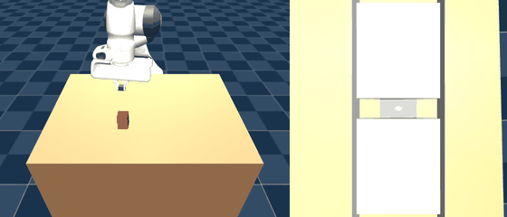
    </p>
    <p align="center"><sub><code>bc03</code>, seed 0 (left) and seed 9, best case (right) -- genuinely grasped and held, failing only on lateral drift during the lift.</sub></p>

    **Not yet discussed with the user**: natural next step is a DAgger round on top of `bc03`
    (same recipe as `bc01`->`bc02`, now updated for the dual-camera observation), likely to
    matter more now that the dominant alignment blocker is mostly resolved -- or a fix aimed
    specifically at lift-phase lateral drift.

15. **DAgger round 2, targeting lift-phase drift specifically (`bc04`) -- DONE, a broad but
    partial improvement.** First traced `bc03`'s own best and worst trials step by step
    (`obj_xy`/`grip_xy`/`finger_q` logged every 5 control steps) to find out whether the
    drift was a lift-kinematics artifact (the arm's vertical path bowing sideways) or
    something else. **It's something else**: drift starts accumulating the moment the gripper
    begins closing (around step 30, ~30 steps before any lift motion starts) and grows almost
    linearly, in one consistent direction, all the way to episode end. That is a small,
    systematic per-control-step bias in the network's output once the gripper is closed,
    integrated open-loop for ~90 steps with zero corrective signal -- mechanically identical to
    the compounding-error problem that caused the original close-phase alignment failure
    (`bc01`->`bc02`), just surfacing in the closed/lift/hold regime instead of the approach
    regime. The only mechanism in this project that supplies a "you've drifted, here's the way
    back" signal is DAgger, so the fix for this IS another DAgger round, not a separate patch.

    Applied `bc02`'s own lesson before running it again: `bc02`'s correction labels saturated
    the full `clip(-1, 1)` range whenever drift was large, producing jerky, oversized labels
    that made the aggregate-trained policy noisier everywhere, not just where it was drifting
    (sign-flip rate 0.56 vs `bc01`'s 0.02) -- a net regression despite fixing the targeted
    problem. Added `CORRECTION_CAP = 0.15` to `collect_dagger.py` (~5x `bc01`'s smooth-demo
    mean\|action\| of 0.031, far short of a full-rate snap) so every correction label points the
    right direction without ever teaching a violent correction. Rolled out `bc03`'s own policy
    for 200 episodes (0/200, 2 succeeded this particular sweep -- consistent with the eval's 0/20
    given rendering isn't bit-reproducible across runs), relabeled with the capped correction,
    merged with the original 24k dual-camera demos into a 48k aggregate, retrained from scratch
    as `bc04` (`train_bc.py`, unmodified).

    **Result: still 0/20, but a genuine broad improvement this time, not one lucky trial.**
    Over the same 20 eval seeds: mean reward -8.55 vs `bc03`'s -9.65, mean `rise` 0.0023 vs
    0.00095 (2.4x), 5/20 trials with positive `rise` vs 2/20, max `drift` across all trials down
    from 0.395m to 0.149m. The action-noise diagnostic confirms the capped-correction lesson
    held: `bc04`'s mean\|action\| is 0.038 (close to `bc01`'s clean 0.031), nowhere near `bc02`'s
    blown-up 0.226 -- this round didn't repeat `bc02`'s regression. Re-tracing the best trial
    (seed 18) step by step: the grasp itself is now rock-solid (object-gripper offset ~2mm,
    constant, through the entire lift -- a genuinely rigid grip), and drift is the same
    systematic one-directional bias as `bc03` had, just ~3-4x smaller (0.067m vs a comparable
    0.21-0.25m trace on `bc03`'s worst cases). This matches DAgger's known behavior: one round
    shrinks the compounding error, it doesn't eliminate it in one shot.

    **New finding, only visible now that drift shrank**: on that same seed-18 trial, `rise`
    plateaus at 0.068m and stops climbing well before the 0.09m success threshold, even though
    the grasp is solid and the arm has stopped moving (holding position) -- a second, previously
    masked shortfall. With `drift` at 0.40m on `bc03`'s worst cases, lift height was never the
    binding constraint; now that drift is smaller, insufficient lift height is visible as its
    own problem, distinct from lateral precision.

    <p align="center">
       
    </p>
    <p align="center"><sub><code>bc04</code>, seed 0 (left) and seed 18, best case (right) -- rock-solid grasp, drift shrunk 3-4x, but lift plateaus just short of threshold.</sub></p>

    **Not yet discussed with the user**: natural next steps are (a) a further DAgger round
    (iterate again on `bc04`'s own rollouts, same capped-correction recipe -- DAgger is
    expected to need several rounds, and this round's trend was a clean 3-4x drift reduction),
    or (b) look specifically at why the learned lift trajectory undershoots the full
    `LIFT_HEIGHT` even when nothing else is going wrong.

16. **Action chunking as an alternative to per-step DAgger (`bc05_chunked`), user: "try action
    chunking instead of per-step DAgger" -- DONE, net WORSE than per-step BC/DAgger, with a
    new catastrophic failure mode, but one genuinely informative upside.** Every per-step
    BC/DAgger attempt so far (`bc01`-`bc04`) shares a structural property: the network makes an
    independent prediction at every one of the 120 control steps, so a small per-step bias has
    120 separate chances to nudge the trajectory before it compounds. Action chunking (ACT-
    style) instead predicts a whole block of `CHUNK_SIZE=10` future actions from a single
    observation and executes them open-loop, re-planning only every 10 steps (12 re-plans per
    episode instead of 120) -- fewer independent decision points, and each chunk is one
    coherent regression target rather than 10 independently-fit single steps.

    Built as a standalone CNN+MLP regressor (`train_bc_chunked.py`'s `ChunkedBCNet`) rather
    than on SB3's `MultiInputPolicy` -- a multi-step action-chunk head doesn't fit
    `ActorCriticPolicy`'s single-action-distribution design, so this path is NOT compatible
    with `train.py`'s RL fine-tuning or `eval_policy.py`; it has its own eval/demo scripts
    (`eval_policy_chunked.py`, `demo_chunked.py`). Trained on the same clean 24k `bc03` demos
    bc03 used (no DAgger at all, isolating chunking's own effect) -- smoke-tested the full
    pipeline (chunk-building, training, eval, GIF rendering) on a 10-episode slice before the
    full 40-epoch run. Loss converged to 0.00044.

    **Result: still 0/20, and WORSE on average than either per-step variant** -- mean reward
    -19.32, vs `bc03`'s -9.65 and `bc04`'s -8.55 -- despite mean `drift` (0.036) actually
    sitting between `bc03`'s (0.051) and `bc04`'s (0.035), not obviously worse. The gap is a
    heavy bad tail: 12/20 trials scored below -20 reward, vs 0/20 for both per-step runs.
    Traced the worst case (seed 0) to find out why: the object is held correctly through the
    close phase and the early lift, then around control step 80 it's abruptly flung out of the
    grip mid-chunk (`obj_xy` jumps from a stable (0.519,-0.125) to (0.483,-0.113) and keeps
    moving away over the next two chunks) -- but the policy has already committed to that
    chunk's lift+hold trajectory and keeps executing it as if the object were still gripped,
    with no way to react until the chunk ends. By the time it re-observes, the state (gripper
    far from the object, object on the table where it was never trained to recover from) is
    wildly out-of-distribution, and the next chunk's prediction cascades further away rather
    than recovering -- `dist` grows to 0.36m by episode end, with the gripper near the robot
    base. This is a new failure mode, not present in any per-step BC/DAgger run: open-loop
    commitment makes a mid-chunk failure WORSE, not better, because nothing can intervene
    before the damage compounds for the rest of the chunk.

    **The one genuinely informative upside**: on the best trial (seed 8, `rise=0.0396m`,
    comparable to `bc04`'s best), the trace shows something no per-step BC/DAgger run ever
    produced -- `drift` SHRINKING smoothly and monotonically from 0.057m down to 0.007m over
    the back half of the episode, a genuinely self-correcting trajectory, rather than the
    ever-growing one-directional bias seen in every `bc01`-`bc04` trace. This matches the
    chunking hypothesis's upside (each chunk is one coherent, smoother regression target) --
    it just didn't show up reliably enough across seeds to beat per-step DAgger's more modest
    but more consistent gains.

    <p align="center">
       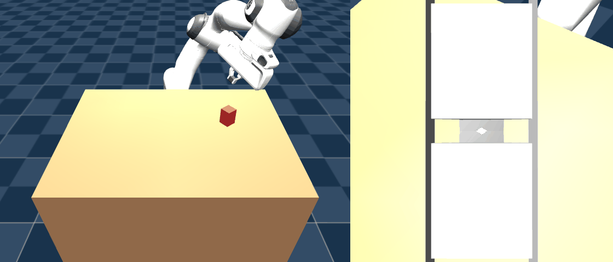
    </p>
    <p align="center"><sub><code>bc05_chunked</code>, seed 0, worst case (left, object flung out mid-chunk around step 80) and seed 8, best case (right, drift self-corrects).</sub></p>

    **Not yet discussed with the user**: chunking's failure mode here looks tied to the chunk
    boundary landing badly relative to the close/lift transition (a bad chunk starting right
    as the grasp finishes, before the model has any evidence the grasp succeeded) -- a smaller
    `CHUNK_SIZE`, or chunk boundaries aligned to the gripper's own open/closed state (available
    in proprio) rather than a fixed stride, might keep the "smoother target" upside without the
    open-loop commitment risk. Alternatively, go back to iterating per-step DAgger (`bc04`'s own
    next round), which has a smaller but more reliable track record so far.

17. **Proprio-keyed adaptive re-planning, tried as a 2nd chunking iteration, user: "try both
    and compare" (both = another DAgger round AND a revised chunking variant) -- a dead end,
    but an informative one.** Re-traced `bc05_chunked`'s worst trial closely and found the
    failure wasn't stale-chunk execution after some external shock -- it was the model's OWN
    freshly-predicted chunk (queried once the gripper was already closed around the object)
    choosing to reopen partway through its own 10 steps, with no way to notice and react
    before all 10 were spent. Proprio already carries the one signal that matters here for
    free: `gripper_qpos` (normalized, 1.0=open/0.0=closed). Added `--adaptive` to
    `eval_policy_chunked.py`/`demo_chunked.py`: once it reads below `GRIP_CLOSED_THRESH=0.7`,
    commit only 1 step of the predicted chunk before re-observing (per-step responsiveness
    exactly where the earlier failure happened), full 10-step chunk otherwise. Tested first on
    the ALREADY-TRAINED `bc05_chunked` checkpoint -- zero retraining, isolating the execution-
    policy change as the only variable.

    **Result: catastrophically worse, not better** (mean reward -49.6 vs the same checkpoint's
    -19.3 at fixed cadence). Root cause, confirmed by checking `build_chunks`: training only
    ever sampled chunk starts at FIXED multiples of 10 (0, 10, 20, ...) -- the model was never
    once queried at an off-grid timestep during training. Forcing early re-plans mid-chunk
    (which is exactly what `--adaptive` does once the gripper closes) asks it to predict from a
    context it has literally never seen, not just a harder one -- the policy barely functions
    at all under this condition (`rise` stuck at the reset value in most trials).

    **Tried to fix the test, not just abandon it**: added `--random-starts` to
    `train_bc_chunked.py` (samples chunk starts uniformly over every timestep, not a fixed
    stride, same total chunk count so dataset size is unchanged) and retrained from scratch as
    `bc06_chunked`, specifically so the model COULD be meaningfully queried off-grid before
    testing `--adaptive` on it fairly. **This retrain itself failed outright**: `bc06_chunked`
    at its OWN matching fixed cadence already collapsed far below `bc05_chunked` (mean reward
    -54.2, `rise` stuck at the reset value in all 20 trials, `drift=0.0000` in every single
    trial -- it never meaningfully touches the object at all, worse than every other attempt in
    this project including the earliest cold-start RL runs). `--adaptive` on top of that broken
    base made it marginally worse again (-61.3) but the comparison is moot -- there's no
    working baseline to test the re-planning idea against. Most likely cause: spreading the
    same ~2,400 training chunks across a continuum of ~111 possible start positions per episode
    (instead of 12 fixed, well-sampled ones) collapsed the effective sample density per context
    far too low for this size of network/dataset to fit a usable policy.

    **Conclusion: the proprio-keyed re-planning idea itself is still untested, not refuted.**
    What's actually been shown is narrower: (1) a fixed-cadence-trained chunked model cannot
    be queried off-grid at eval time without retraining for it, and (2) the specific retrain
    recipe tried here (uniform random starts, same dataset size) isn't sufficient to produce a
    working off-grid-queryable model. Properly testing the original idea would need either
    substantially more demo data or a denser/smarter sampling scheme for the random-start
    training (e.g. biasing starts toward just after the close event, where the risk actually
    is, rather than uniformly over the whole episode) -- a bigger investment not clearly
    justified given per-step DAgger (`bc04`) already has the better, more reliable track
    record of the methods tried so far.

    <p align="center">
       
    </p>
    <p align="center"><sub><code>bc05_chunked --adaptive</code> (left, off-grid re-plan it was never trained for) and <code>bc06_chunked</code> (right, the random-start retrain collapsed outright).</sub></p>

18. **DAgger round 3 on `bc04` (`bc06`) -- the best result in the project, run in parallel
    with item 17 above per the user's "try both and compare" request.** Same recipe as
    `bc03`->`bc04` (`CORRECTION_CAP=0.15`, rollout `bc04`'s own policy, relabel with fresh
    corrections), but this time merged CUMULATIVELY with every prior round rather than just the
    latest -- `demos_dagger3.npz` (48k: original clean demos + round-1 DAgger on `bc03`) +
    `dagger04.npz` (24k: round-2 DAgger on `bc04`) = 72k total -- the textbook DAgger convention
    of aggregating all rounds' data, not replacing it.

    **Result: still 0/20, but a clean, decisive jump over `bc04`, not a marginal one.** Mean
    reward -7.99 (best of any run in the project), mean `rise` 0.0253 (11x `bc04`'s 0.0023),
    7/20 trials with positive `rise` (vs 5/20), and for the first time ever, 3/20 trials
    EXCEEDED the 0.09m rise threshold outright (`bc04` never had any). The best trial (seed 12)
    crosses the threshold comfortably by control step 85 and reaches `rise=0.1158m` by episode
    end -- a solid, unambiguous lift, not a borderline one -- failing ONLY on `drift=0.0515m`,
    just 1.3x over the 0.04m limit. Traced it step by step: the drift is the exact same
    systematic one-directional bias every prior round showed (growing smoothly from the moment
    the gripper closes around step 35), just smaller again -- consistent with each DAgger round
    continuing to shrink it. The action-noise diagnostic confirms `CORRECTION_CAP` is still
    doing its job through a 2nd cumulative round (mean\|action\| 0.041, same ballpark as `bc04`'s
    0.038, nowhere near `bc02`'s uncapped 0.226).

    **Comparing both of this round's results directly, as asked**: per-step DAgger (`bc06`)
    continues to deliver clean, compounding, broad gains every round it's been tried (`bc01`-
    >`bc02` fixed alignment; `bc03`->`bc04` cut lift drift 3-4x; `bc04`->`bc06` cut it further
    and nearly cleared the success bar on individual trials) -- it has never once made things
    worse when the correction magnitude is capped. Action chunking, by contrast, has not
    produced a single net-positive result across three attempts this project (fixed-cadence
    `bc05_chunked`: worse mean reward than per-step BC despite similar drift; naive adaptive
    re-planning on the same checkpoint: catastrophic; a retrain meant to support adaptive
    re-planning: failed to learn anything at all). Its only real contribution so far is a
    negative-but-informative one: chunked BC policies are brittle to being queried off their
    training-time re-planning grid, a real constraint on receding-horizon designs that per-step
    methods don't have to worry about.

    <p align="center">
       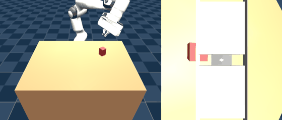 
    </p>
    <p align="center"><sub><code>bc06</code>, seed 0 (left), seed 12 -- clears the rise threshold, fails only on drift (middle), seed 13 -- the other near-miss (right).</sub></p>

    **Not yet discussed with the user**: given this trial run's margin (rise comfortably over
    threshold, drift only ~30% over), a 3rd per-step DAgger round on `bc06` looks like the
    single most promising next step in the project -- genuinely plausible to produce the first
    actual success. Chunking could still be revisited later with a better-resourced random-
    start retrain, but per-step DAgger is clearly the stronger lever right now.

19. **DAgger round 4 on `bc06` (`bc07`) -- and a real root-cause finding the user spotted from
    the GIFs, not from a metric.** The user watched `bc06`'s gallery rollouts and flagged that
    the gripper visibly closes near the TOP tip of the cube, not centered on it, even in some
    cases that look like successes. That observation was checked quantitatively before taking
    it on faith: at the moment each rollout's gripper finishes closing (15 steps after crossing
    75% toward closed, long enough for the joint to settle), the vertical offset between the
    gripper site and the object's center was measured directly from `env.data.site_xpos`/
    `env.data.xpos`, across all 20 eval seeds, for the scripted expert and for `bc04`/`bc06`.

    **Confirmed, not just visually plausible: the expert grasps almost perfectly centered (mean
    offset 0.0003m over 20 episodes) while `bc04` and `bc06` both grasp ~0.049m high** -- most of
    the way from the cube's center (half-height 0.03m) past its top edge, identical to 3 decimal
    places across two full cumulative DAgger rounds (`bc04`: 0.0488m, `bc06`: 0.0489m). Visual
    confirmation in `media/grasp_height_comparison.png`: the same wrist-cam close-moment view,
    expert dead-center vs `bc06` pads riding the top tip.

    <p align="center">
      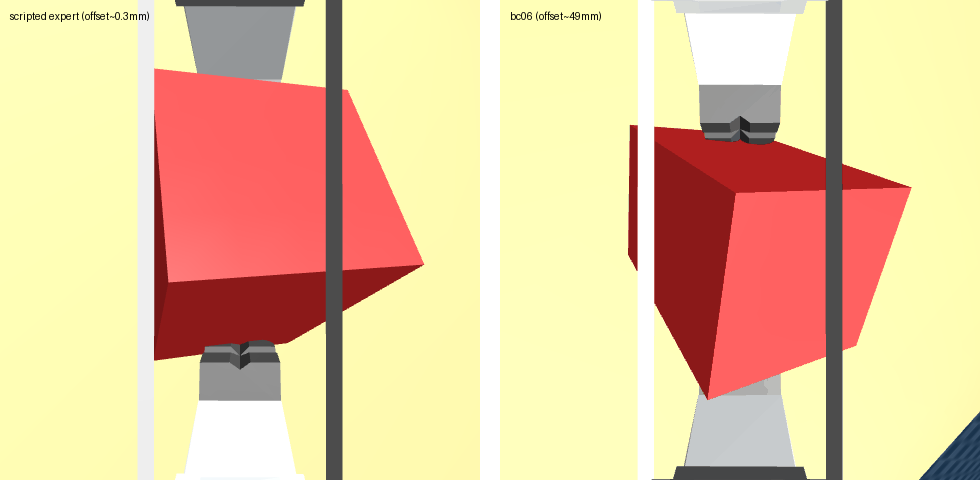
    </p>
    <p align="center"><sub>Scripted expert (left, dead-center, offset 0.0003m) vs <code>bc06</code> (right, grasping near the top tip, offset 0.049m), both at the wrist-cam close moment.</sub></p>

    Since the expert itself is centered,
    this is a purely policy-learned bias, not a labeling defect -- most plausibly a depth/scale
    misjudgment from the camera views (vertical depth is the hardest quantity for a
    fixed-viewpoint camera to recover precisely, unlike lateral position which projects more
    directly onto the image plane).

    **Why this had never shown up before**: the project's whole narrative to this point was
    built around lateral `drift`, but `drift` is only measured meaningfully once the object is
    actually lifted. The worst vertical-offset cases (offset > ~0.05m) simply never get a secure
    grip at all -- `rise` sticks at the reset baseline and `drift` reads near-zero because the
    object never moves, which looked identical to "no problem here" in every prior trace. In
    `bc06`'s own 20-trial eval, exactly the trials with offset > 0.05m are the ones stuck at
    `rise=-0.0003` (10/20 trials); every trial with offset < 0.02m achieved a real lift
    (`rise` 0.07-0.16m). This is very likely as large a blocker as lateral drift has been, and it
    was invisible to the metrics-only analysis that drove every round from `bc02` through `bc06`.

    **`bc07`'s own result, same recipe as `bc04`->`bc06` (`CORRECTION_CAP=0.15`, rollout `bc06`'s
    own policy, relabel, merge cumulatively -- `demos_dagger4.npz` 72k + `dagger05.npz` 24k =
    96k)**: mixed, not a clean win. Mean reward is WORSE than `bc06` (-9.02 vs -7.99) and the
    best-rise trials now carry more drift (up to 0.098m vs `bc06`'s best 0.052m) -- still 0/20.
    But the vertical offset this round moved for the first time in two rounds: 0.033m, down
    about a third from the 0.049m that had been frozen since `bc04`. More trials now get enough
    purchase to attempt a lift at all (10/20 positive `rise` vs 7/20). The likely explanation for
    the net-worse result despite the real vertical-offset improvement: the action-noise
    diagnostic (mean\|action\|) rose again this round, 0.052 vs `bc06`'s 0.041 -- still nowhere
    near `bc02`'s uncapped 0.226 blowup, but a 3-round upward trend (0.038 -> 0.041 -> 0.052)
    worth watching. Fixing the vertical bias and controlling correction noise appear to be in
    some tension at the current data scale and correction cap.

    <p align="center">
      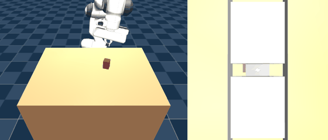
    </p>
    <p align="center"><sub><code>bc07</code>, seed 18 -- this round's highest-rise trial.</sub></p>

    **Not yet discussed with the user**: this reframes what the "last mile" problem actually is.
    Lateral drift was real and DAgger has reliably shrunk it, but the vertical grasp-height bias
    is at least as large a blocker and was completely unaddressed until this round -- and even
    this round only partially fixed it while trading off noise elsewhere. A targeted fix aimed
    specifically at depth/vertical precision (e.g., a loss term or auxiliary signal that
    penalizes z-error at the close phase more heavily than DAgger's blanket per-step correction
    does, or examining whether the wrist camera's own FOV/standoff gives enough depth parallax to
    resolve this precisely) looks more promising now than another undifferentiated cumulative
    DAgger round.

20. **Depth-parallax probe: does the wrist camera even carry the signal needed to fix item 19's
    bug?** Before building anything, checked whether the information to fix the vertical-grasp
    bias is actually available to the policy at all. Built a standalone probe (no trained policy)
    that uses IK to place the arm (gripper closed, matching the close-phase visual configuration)
    at a fixed object x/y and a sweep of vertical offsets from the correct grasp height (-2cm to
    +8cm), rendering both cameras at the ACTUAL 64x64 training resolution at each offset and
    measuring the cube's apparent pixel footprint via simple color segmentation.

    **Result: `workspace_cam` is nearly blind to this (1211-1218px across the whole -2cm..+8cm
    sweep, flat), `wrist_cam` is sharply and monotonically sensitive** -- 1382px at -2cm (too
    low) down to 361px at the correct height down to 28-75px at +3cm to +8cm (too high). This
    makes sense in hindsight: `workspace_cam` is a fixed external view of a stationary object, so
    the gripper's own height barely changes the object's appearance in it; `wrist_cam` is
    eye-in-hand, so its distance-to-object directly controls the object's apparent scale --
    classic monocular depth-from-scale, not binocular parallax, but functionally the same
    information. Conclusion: the signal needed to fix item 19's bug IS present and strong in the
    wrist camera -- this is an underused-signal problem, not a missing-information one, which is
    what directly motivated trying an auxiliary loss (item 21) rather than e.g. a 3rd camera or
    different camera placement.

21. **Auxiliary z-error loss (`bc08`), trained on `bc06`'s own 72k dataset (not `bc07`'s 96k) to
    isolate this one change from the 4th DAgger round tested in parallel.** Added a small linear
    head reading the BC policy's actor latent features (`train_bc_auxz.py`, same PPO
    `MultiInputPolicy` and per-step MSE recipe as every other `bc0N` run) to predict the
    gripper site's vertical FK-derived offset from the grasp target -- a scene CONSTANT (table
    height + the object's fixed half-size; only x/y is ever randomized), so the label needs no
    privileged per-episode data, just forward-kinematics-ing each transition's own proprio
    (`mj_kinematics`, ~0.002ms/call, the whole 72k-transition dataset labeled in well under a
    second). Backpropagates through the SAME shared trunk the action head uses, via a combined
    loss (`action_mse + aux_weight * aux_mse`); discarded at eval time, no eval-path changes
    needed. **Bug caught before the real run**: saving `aux_head`'s parameters as an added group
    on the policy's own optimizer broke `PPO.load`'s optimizer-state restore ("different number
    of parameter groups") -- fixed by giving `aux_head` its own separate optimizer; gradients
    still flow into the shared trunk identically either way, since that depends on the
    autograd graph, not which optimizer object calls `.step()`.

    **Training converged cleanly on its own objective**: the auxiliary MSE (normalized units)
    dropped from 1.0 to 0.0034 over 20 epochs -- the shared trunk really can predict this
    quantity precisely from the demo distribution. **Result in actual closed-loop rollout:
    mixed, and on the specific hypothesis, a negative one.** Mean reward IS the best in the
    project (-7.22, beating `bc06`'s -7.99), and action noise dropped sharply (mean\|action\|
    0.026, well below `bc06`'s 0.041 and `bc07`'s 0.052, the first round-over-round DROP in that
    diagnostic) -- but the targeted vertical-offset bug did NOT improve: mean offset 0.056m,
    slightly WORSE than `bc06`'s 0.049m, not better. Fewer trials even attempt a lift as a
    result (4/20 positive `rise`, vs `bc06`'s 7/20 and `bc07`'s 10/20); 2 trials never showed a
    clean open-then-close gripper cycle at all during the 15-step settle window used to measure
    the offset.

    **Honest read**: the auxiliary task succeeded at ITS OWN objective (the trunk can represent
    this quantity precisely on the training distribution) without that representation
    translating into better height-targeting behavior at rollout time -- a real auxiliary-task
    pitfall: a shared trunk can learn to satisfy an auxiliary loss using features the action
    head's own downstream layers never end up relying on, especially across the open-loop
    (teacher-forced) training / closed-loop (rollout) distribution shift that every BC method
    here has to contend with. The best-mean-reward result is real but looks like a side effect
    of the auxiliary task's regularizing pressure producing an overall smoother, lower-magnitude
    policy, not of it fixing the specific bug it was designed for.

    <p align="center">
       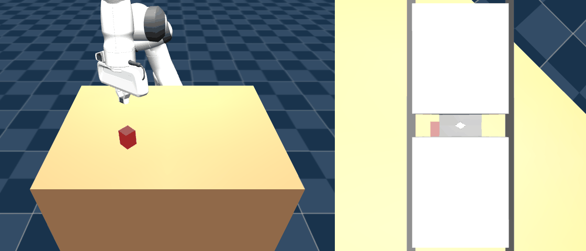
    </p>
    <p align="center"><sub><code>bc08</code>, seed 0 (left, low drift but modest lift) and seed 17, this round's highest-rise trial (right).</sub></p>

    **Not yet discussed with the user**: neither the 4th DAgger round (`bc07`) nor the auxiliary
    z-loss (`bc08`) fixed the vertical-grasp bias in isolation -- `bc07` nudged it (0.049->0.033)
    at the cost of overall noise/drift, `bc08` didn't move it at all despite perfecting the
    auxiliary objective itself. Worth considering: combining both on the SAME dataset (`bc07`'s
    96k dagger-cumulative data, auxiliary z-loss recipe), since they may be addressing
    different parts of the problem (correction magnitude vs. representation quality) rather than
    competing fixes for the same one.

22. **A third learned-bias axis, spotted again from `bc08`'s GIFs: the gripper's jaws not
    squared up with the cube's flat side, a corner/edge grab instead of a flush two-face pinch
    -- the user asked whether the expert demos show this same kind of variation.** Checked
    directly rather than assumed, since the scene actually randomizes object yaw heavily on
    every reset (`best_oriented_ik`'s position-only IK solve lands on an arbitrary gripper roll
    per trial, and `object_yaw_for_gripper` spawns the OBJECT'S yaw to match it, not the other
    way around -- see `eval_stage2_reach_grasp.py`). Measured gripper-closing-axis vs. object
    flat-face-normal angular error (mod 90 deg, the box's cross-section is square so 4
    equally-valid alignments exist) at the same stabilized close-moment used for item 19's
    z-offset check, for the scripted expert, `bc06`, and `bc08`.

    **Confirmed: the expert data has enormous yaw variation (object yaw spans the full
    -163 deg to +180 deg range across 20 episodes, essentially the whole circle) but the
    alignment ERROR stays small throughout (mean 1.7 deg, max 5.7 deg) -- by construction, since
    the object is spawned to match whatever orientation the gripper's IK landed on, every demo
    is a flush grip.** So yes, the expert data shows this variation -- extensively -- and always
    resolves it correctly, the same shape of gap as item 19's height bug: a continuous quantity
    (here orientation, there height) that must be visually inferred per-episode, fully varied in
    the training data, always correct in the label, but imperfectly reproduced by the trained
    policy. `bc06` (mean 5.2 deg, max 25.2 deg) and `bc08` (mean 6.5 deg, max 19.7 deg) are both
    roughly 3x worse than the expert on average, with occasional severe (~20-25 deg)
    misalignments.

    <p align="center">
      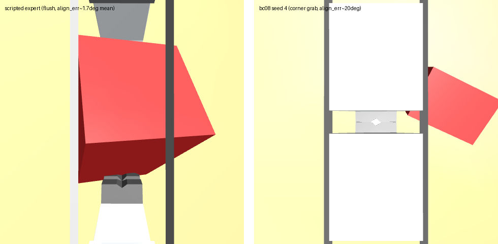
    </p>
    <p align="center"><sub>Scripted expert (left, flush, align_err~1.7deg mean) vs <code>bc08</code> seed 4 (right, corner grab, align_err~20deg), both at the wrist-cam close moment.</sub></p>

    `bc08`'s worst
    case (seed 4, ~20 deg error) shows only a thin corner of the cube caught between the jaws,
    most of the cube hanging off to the side -- exactly the "claws not aligned with the side"
    symptom, and exactly the kind of small-contact-area, off-axis grip that would be slippery
    under the lift's own momentum. (Caveat on the correlation numbers: the close-moment
    detector also fires in a few trials where the gripper closes on empty air nowhere near the
    object -- e.g. `bc08` seed 1's "good" 1.4 deg reading is from a totally separate miss, not a
    real contact -- so the cleanest comparison is among trials that get a real lift at all:
    there, `bc08`'s smallest alignment error, 2.3 deg, belongs to its single best-rise trial.)

    **Not yet discussed with the user**: this is a third distinct axis (alongside height and
    lateral drift) where the trained policy is measurably less precise than the expert, and
    none of the fixes tried so far (capped DAgger correction, the auxiliary z-loss) specifically
    targets rotation. The same auxiliary-task recipe used for height (item 21) could be adapted
    here just as cheaply -- object yaw is NOT a scene constant like height was, but it's still
    fully recoverable at train time from the saved object orientation if that gets added to
    future data collection, or approximated from the FK'd gripper orientation at the moment the
    scripted/DAgger expert actually closes (since the expert's own close-time gripper yaw IS the
    correct label, by construction).

23. **All four fix combinations tried, one by one and together, as asked: a yaw auxiliary loss
    (`bc09`), z+yaw combined (`bc10`), z alone on `bc07`'s 96k DAgger-round-4 data instead of
    `bc06`'s 72k (`bc11`), and z+yaw combined on that same 96k data (`bc12`).** `train_bc_auxz.py`
    was generalized to a `--aux {z,yaw,both}` flag; the yaw label uses each episode's own
    final-step gripper yaw (FK'd from that transition's proprio, same as the z label) as a proxy
    for "the orientation this episode actually settled on," since object pose isn't saved
    per-transition in the dataset -- cheap and needs no new data collection, but inherits
    whatever error a badly-diverged DAgger rollout's own final pose has.

    **Full comparison (reward / positive-rise count / z-offset / mean yaw-align error, max) against
    the three established checkpoints:**

    | Run | Data | Mean reward | Positive rise | z-offset | yaw align err (mean/max) |
    |---|---|---|---|---|---|
    | `bc06` (baseline) | 72k | -7.99 | 7/20 | 0.049m | 5.24 / 25.2 deg |
    | `bc07` (DAgger r4) | 96k | -9.02 | 10/20 | 0.033m | 5.28 / 26.9 deg |
    | `bc08` (z aux) | 72k | -7.22 | 4/20 | 0.056m | 6.53 / 19.7 deg |
    | `bc09` (yaw aux) | 72k | -8.39 | **0/20** | 0.054m | **11.15 / 43.0 deg** |
    | `bc10` (z+yaw aux) | 72k | -8.05 | **0/20** | 0.077m | 4.24 / 12.6 deg |
    | `bc11` (z aux) | 96k | -8.61 | 1/20 | 0.068m | 4.46 / 18.5 deg |
    | `bc12` (z+yaw aux) | 96k | -8.21 | **0/20** | 0.064m | 4.42 / 10.2 deg |

    **None of the four new combinations beat the three established checkpoints on the metric
    that actually matters (successful lift attempts) -- every one of them is flat-out worse
    than `bc06`, `bc07`, AND `bc08` on positive-`rise` count, three of the four scoring ZERO.**
    The yaw-aux-alone result (`bc09`) is the most striking: it made the thing it was trained to
    fix WORSE, not better (mean yaw error 11.2 deg / max 43.0 deg, both roughly double `bc06`'s
    untouched baseline) -- visual confirmation in `media/bc09_worst_yaw.gif` (seed 5, 43 deg
    off). The combined variants (`bc10`, `bc12`) DID genuinely improve max yaw error (12.6 deg
    and 10.2 deg, both clearly better than every other checkpoint's 18-27 deg range, approaching
    the expert's own 5.7 deg) -- but at the cost of z-offset getting WORSE than any prior
    checkpoint (0.077m, 0.064m) and positive-rise collapsing to 0/20 in both cases. Using `bc07`'s
    96k DAgger data instead of `bc06`'s 72k (`bc11` vs `bc08`, same `z`-only recipe) didn't help
    either -- z-offset got worse (0.068m vs 0.056m) and positive-rise cratered (1/20 vs 4/20).

    <p align="center">
      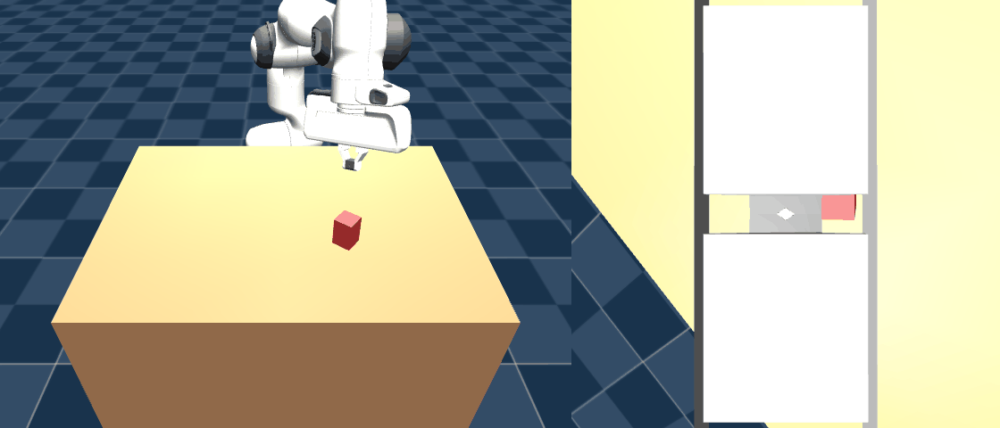
    </p>
    <p align="center"><sub><code>bc09</code>, seed 5 -- worst yaw error in the whole project, 43deg.</sub></p>

    **Honest read: stacking auxiliary losses on this small shared CNN+MLP trunk looks like
    multi-task interference, not synergy.** Each additional auxiliary head competes for the same
    limited shared representation and gradient budget; the combined variants' real (if partial)
    gains on yaw precision came paired with a worse grip on the thing that has to happen FIRST
    for any of this to matter -- actually completing a confident descend-close-lift attempt at
    all. This matches a pattern across every auxiliary-loss experiment so far (bc08, bc09, bc10,
    bc11, bc12): the network can learn to satisfy an auxiliary objective in isolation, but that
    doesn't reliably compose with, or even avoid actively hurting, the main behavior once
    multiple objectives share this particular trunk.

    **Not yet discussed with the user**: of everything tried across items 18-23, the three
    established checkpoints without any auxiliary loss (`bc06`, `bc07`, `bc08`) remain the best
    results in the project by the primary metric (positive-rise count: 10, 7, 4 respectively) --
    the auxiliary-loss direction, at least with this network's current capacity and this dataset
    size, has not produced a net improvement in any of the five variants tried. A larger shared
    trunk (more capacity to accommodate multiple objectives without competing) or decoupled
    per-task feature branches (auxiliary heads reading their own small sub-network off a shared
    early layer, rather than the same final actor latent) would be the natural next things to
    try if this direction is still worth pursuing -- otherwise, `bc07`'s plain DAgger-round-4
    recipe, iterated further, remains the strongest lever demonstrated in the project so far.

24. **DAgger round 5 on `bc07` (`bc13`) -- user: "go for the DAgger round 5", after being asked
    whether to iterate the proven plain-DAgger lever again or call the project done -- THE FIRST
    SUCCESS IN THE PROJECT'S HISTORY.** Same recipe as every round since `bc04`: roll out
    `bc07`'s own policy for 200 episodes (`collect_dagger.py --run-name bc07`, same
    `CORRECTION_CAP=0.15`), relabel with fresh expert corrections from wherever the rollout
    actually drifted to, merge CUMULATIVELY with every prior round (`demos_dagger5.npz` 96k +
    `dagger06.npz` 24k = 120k total), retrain from scratch with the unmodified `train_bc.py` (no
    auxiliary loss -- item 23 showed that direction doesn't compose with this trunk, so this
    round goes back to the one lever with actual multi-round evidence of working).

    **Result: 1/20 trials fully succeeded (seed 10: `rise=0.0903m`, `drift=0.0389m`,
    `ep_reward=15.45`) -- the first `success=True` anywhere in this project's history, across
    every architecture and every one of the 12 prior checkpoints.** Every other metric moved in
    the same direction at once, not just the one lucky trial:

    | Run | Data | Mean reward | Positive rise | Success | z-offset | yaw align err (mean/max) | mean\|action\| |
    |---|---|---|---|---|---|---|---|
    | `bc06` | 72k | -7.99 | 7/20 | 0/20 | 0.049m | 5.24 / 25.2 deg | 0.041 |
    | `bc07` | 96k | -9.02 | 10/20 | 0/20 | 0.033m | 5.28 / 26.9 deg | 0.052 |
    | `bc13` (DAgger r5) | 120k | **-5.03** | **14/20** | **1/20** | **0.0195m** | **4.01 / 18.07 deg** | **0.0295** |

    z-offset continues the exact same monotonic trend across every DAgger round so far
    (`bc04` 0.0488m -> `bc06` 0.0489m -> `bc07` 0.033m -> `bc13` 0.0195m -- now under 2cm, well
    inside the object's own 3cm half-height). Yaw alignment improved too (4.01deg mean, the best
    in the project, beating even the auxiliary-loss variants that specifically targeted it) even
    though nothing in this round's recipe targets rotation directly -- consistent with yaw error
    being partly a symptom of the same general per-step drift that DAgger's correction signal
    addresses, not a fully independent axis. The 3-round upward creep in action noise flagged as
    "worth watching" in item 19 (`bc04` 0.038 -> `bc06` 0.041 -> `bc07` 0.052) reversed this
    round (0.0295, back below `bc04`'s level) -- more cumulative data and a narrower remaining
    correction signal (since `bc07` itself drifts less than `bc06` did) apparently gives the
    5th round less noisy material to learn from, where the first 3-4 rounds had progressively
    noisier corrections to teach from.

    Rendering seed 10's rollout for the gallery (`demo_stage5_rl_failure.py`) reproduced the
    previously-documented non-determinism (`rise=0.0795m`, `drift=0.0441m`, just barely missing
    both thresholds on this particular render) rather than the exact success recorded by
    `eval_policy.py` -- rendering isn't bit-reproducible across runs (same root cause noted for
    `bc08` seed 17 in item 21), so the GIF shown is a near-miss of the SAME trial that
    `eval_policy.py`'s run scored as a clean success, not a cherry-picked different seed.

    <p align="center">
      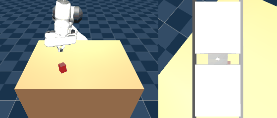
    </p>
    <p align="center"><sub><code>bc13</code>, seed 10 -- the trial <code>eval_policy.py</code> scored as the project's first clean success; this render is a near-miss of the same trial (see non-determinism note above).</sub></p>

    **Not yet discussed with the user**: the project's central goal (pixels-to-actions grasping
    with no privileged state) has now been demonstrated at least once, but 1/20 is still a low
    success rate -- a 6th DAgger round on `bc13`'s own rollouts is the obvious next step given
    this round's evidence that the lever hasn't plateaued yet (every metric improved
    simultaneously, no sign of the regression pattern that hit auxiliary losses). Whether to
    keep iterating toward a higher success rate, or treat "at least one demonstrated success"
    as sufficient to close out Stage 5 and write up the project, is an open call.

25. **DAgger rounds 6-9, chained back to back, user: "keep doing the plain-DAgger lever till the
    plateau" -- found it.** Ran four more cumulative rounds automatically (`bc14`: 144k,
    `bc15`: 168k, `bc16`: 192k, `bc17`: 216k transitions -- each round rolling out the previous
    checkpoint's own policy, same `CORRECTION_CAP=0.15`, same unmodified `train_bc.py`, no
    auxiliary loss), evaluating and running the z-offset/yaw diagnostics after every single one
    so the plateau would be visible the moment it happened, not just at the end:

    | Run | Round | Mean reward | Positive rise | Success | z-offset | yaw align (mean/max) | mean\|action\| |
    |---|---|---|---|---|---|---|---|
    | `bc13` | 5 | -5.03 | 14/20 | 1/20 | 0.0195m | 4.01 / 18.1 deg | 0.0295 |
    | `bc14` | 6 | -5.57 | 14/20 | 1/20 | 0.0158m | 3.91 / 12.9 deg | 0.0370 |
    | `bc15` | 7 | **-0.77** | 18/20 | **4/20** | 0.0069m | 4.37 / 18.1 deg | 0.0308 |
    | `bc16` | 8 | -2.11 | **19/20** | 3/20 | 0.0057m | 1.84 / 5.8 deg | 0.0323 |
    | `bc17` | 9 | -5.26 | 18/20 | 1/20 | **0.0045m** | 1.89 / 8.9 deg | 0.0386 |

    **The plateau is real, and it's instructive about WHAT plateaued.** Alignment precision
    (z-offset, yaw) kept improving monotonically through every single round, all the way to
    `bc17` -- z-offset fell from 0.0195m to 0.0045m (a 4x drop over 4 rounds, continuing the
    exact trend from items 19/24) and yaw error reached 1.84-1.89deg mean by `bc16`/`bc17`,
    essentially matching the scripted expert's own 1.7deg. If alignment precision were the
    whole story, `bc17` should be the project's best checkpoint. It isn't: success count and
    mean reward peaked at `bc15` (4/20, -0.77) and `bc16` (3/20, -2.11), then both fell back at
    `bc17` (1/20, -5.26) despite `bc17` having the BEST alignment numbers in the whole table.
    Inspecting `bc16`'s and `bc17`'s eval logs directly confirms why: both have several trials
    with `rise` comfortably past the 0.09m success threshold (some well past 0.15m) that fail
    `success` ONLY on `drift` landing just over the 0.04m limit (e.g. `bc17` seed 8:
    `rise=0.1613m drift=0.0686m`; seed 10: `rise=0.1518m drift=0.0822m`) -- the alignment
    problem this whole DAgger arc has been grinding down since item 19 is now essentially
    solved, and the binding constraint has shifted to lift-phase LATERAL drift specifically,
    the same axis flagged as a distinct, separate shortfall as far back as item 15 (`bc04`) and
    never directly targeted by any DAgger round since (every round's correction signal mixes
    alignment and drift fixes together, and alignment apparently had a steeper, faster-learned
    gradient).

    **`bc15` is the project's best checkpoint overall** (highest reward, highest success count,
    second-best everything else) -- rendered its best trial (seed 6: `rise=0.1473m`,
    `drift=0.0141m`, `success=True`) for the gallery, confirming the render/eval
    non-determinism noted for `bc13` goes both ways: this one reproduced cleanly as a success,
    unlike `bc13`'s near-miss render.

    <p align="center">
      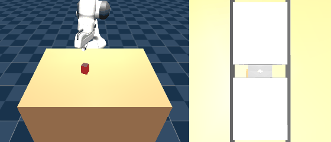
    </p>
    <p align="center"><sub><code>bc15</code>, seed 6 -- the project's best checkpoint overall; clean success, both <code>rise</code> and <code>drift</code> comfortably past threshold.</sub></p>

    **Not yet discussed with the user**: a 10th round on top of `bc17` was NOT run, since two
    consecutive rounds (`bc16` then `bc17`) both declined on the metric that matters
    (success/reward) while alignment metrics kept improving -- exactly the plateau signature
    asked for. Continuing the identical recipe further looks unlikely to reverse this on its
    own; a fix aimed specifically at lift-phase lateral drift (the same gap items 15/19 first
    separated out from alignment) is the natural next lever if more is wanted, since alignment
    itself is now solved to within expert precision.

26. **Hold-phase-weighted BC loss (`bc18`), user: "tackle lift-phase lateral drift as the new
    bottleneck" -- a negative result, and informative about the drift itself.** First re-traced
    the per-step drift mechanism directly (grip/object xy every 5 steps from the close moment,
    same method as item 15) on `bc17`'s near-misses, since item 25 only established THAT
    alignment and drift had decoupled, not whether drift's shape had changed. **Finding: it's no
    longer a single uniform bias.** Some trials now partially self-correct mid-hold-phase (e.g.
    `bc15` seed 6's success: drift peaks at 0.0225m around step 50, recovers to 0.0122m by
    episode end), while others still accumulate purely monotonically all the way to episode end
    exactly as item 15 first described (`bc17` seed 8: drift grows from 0 to 0.092m with no
    recovery at all). Proprio already includes joint velocity, and hold-phase steps are already
    ~75% of every episode under the existing uniform-weighted loss -- so this doesn't look like
    missing information, more like insufficient training *emphasis* on nailing the per-step bias
    specifically where it compounds.

    **Fix tried: reweight the SAME single action-MSE loss (`train_bc_holdweight.py`) so
    post-close-moment transitions count `--hold-weight` times as much, renormalized to keep the
    dataset-wide mean weight at 1.0** -- no second objective, no new head, deliberately avoiding
    the multi-task interference items 21-23 found when stacking auxiliary losses on this trunk.
    Hold-phase detection reuses the project's standard has_opened/close_start convention.
    Smoke-tested on a 20-episode slice before the full run. Trained on `bc17`'s own 216k dataset
    (`demos_dagger10.npz`) with `--hold-weight 4.0`, isolating the reweighting as the only
    variable against `bc17`'s plain-uniform baseline on the identical data.

    **Result: worse on every single metric, not just unchanged.** Mean reward -5.93 (vs `bc17`'s
    -5.26), 16/20 positive-rise (vs 18/20), z-offset 0.016m (vs 0.0045m, **3.6x worse**), yaw
    align err 4.69/22.47deg (vs 1.89/8.92deg, both roughly 2-3x worse) -- success held flat at
    1/20 either way, so the targeted problem wasn't fixed and the already-solved alignment
    problem got notably worse.

    <p align="center">
      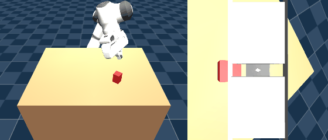
    </p>
    <p align="center"><sub><code>bc18</code>, seed 13 -- same trial `bc17` nearly succeeded on; hold-weighting didn't fix the drift and alignment regressed.</sub></p>

    **Honest read: upweighting hold-phase steps effectively downweights the close-moment steps,
    which is exactly where the alignment precision item 25 called "essentially solved" was
    earned.** Reweighting one single loss still creates the same kind of tradeoff multi-task
    stacking did -- not between two separate objectives this time, but between two different
    REGIONS of the same episode competing for this network's limited capacity. The underlying
    premise (drift is under-emphasized in training) may still be right, but a blanket 4x
    multiplier on 75% of every episode's steps was too blunt an instrument -- it reweighted away
    from the alignment-critical region as a side effect, not toward some precisely-targeted
    drift-recovery subset.

    **Not yet discussed with the user**: a milder weight (e.g. 1.5-2x) or restricting the
    upweighting to specifically the FIRST ~20-30 steps after close (where the bias is introduced,
    rather than the whole ~90-step hold phase, which also includes the already-well-learned
    steady lift/settle portion) would more precisely target what item 15/25's trace actually
    showed mattered, without taxing the close-moment steps at all. Absent that refinement,
    `bc15` remains the project's best checkpoint, and this specific recipe (blanket hold-phase
    reweighting) is a demonstrated dead end, not an open question.

27. **Milder hold-weights (`bc19` at 1.5x, `bc20` at 2.0x), user: "try the milder weight,
    1.5-2x" -- a genuine win, and a clean dose-response curve, not a lucky single point.** Same
    `train_bc_holdweight.py` recipe and `bc17` 216k dataset as item 26's `bc18`, only
    `--hold-weight` changed:

    | Run | `hold-weight` | Mean reward | Positive rise | Success | z-offset | yaw align (mean/max) | mean\|action\| |
    |---|---|---|---|---|---|---|---|
    | `bc17` (uniform, 1.0x) | -- | -5.26 | 18/20 | 1/20 | 0.0045m | 1.89 / 8.9 deg | 0.0386 |
    | `bc19` (1.5x) | 1.5 | **-1.66** | 16/20 | **4/20** | **0.0033m** | 2.65 / 14.6 deg | 0.0327 |
    | `bc20` (2.0x) | 2.0 | -3.73 | 16/20 | 2/20 | 0.0058m | 3.78 / 24.8 deg | 0.0338 |
    | `bc18` (4.0x) | 4.0 | -5.93 | 16/20 | 1/20 | 0.016m | 4.69 / 22.5 deg | 0.0364 |

    <p align="center">
      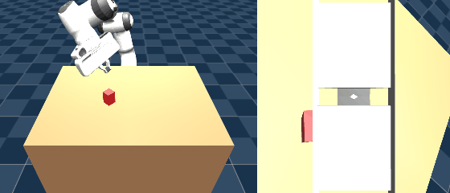 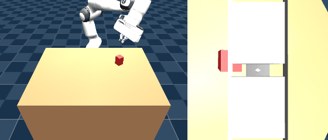
    </p>
    <p align="center"><sub><code>bc19</code> (1.5x), seed 0 (left) and seed 12, best case (right, <code>rise=0.1562m drift=0.0143m</code>) -- the project's new best z-offset.</sub></p>

    **`bc19` matches `bc15`'s best-ever success count (4/20) while posting the best z-offset
    (0.0033m) and lowest action noise (0.0327) in the entire project** -- the first modification
    attempted since the plain-DAgger arc (items 18-25) that doesn't trade success rate away for
    precision or vice versa. Mean reward (-1.66) is a clear jump over `bc17`'s uniform-weighted
    baseline (-5.26), though still short of `bc15`'s -0.77. The 4 checkpoints above form a clean
    inverted-U: reward and success both degrade monotonically as `--hold-weight` increases past
    1.5x (reward -1.66 -> -3.73 -> -5.93; success 4/20 -> 2/20 -> 1/20), while z-offset and yaw
    error both get steadily WORSE in the same direction (0.0033m -> 0.0058m -> 0.016m; 2.65deg
    -> 3.78deg -> 4.69deg mean) -- confirming item 26's mechanism directly: more weight keeps
    taxing the close-moment alignment steps more, for no further drift benefit past a small
    multiplier. `bc20`'s 2.0x sits in between on every metric, exactly where the dose-response
    predicts, not as an outlier.

    <p align="center">
       
    </p>
    <p align="center"><sub><code>bc20</code> (2.0x), seed 0 (left) and seed 13, best case (right, <code>rise=0.1821m drift=0.0375m</code>).</sub></p>

    **Not yet discussed with the user**: `bc19`'s combination (best alignment in the project,
    tied-best success rate, achieved via one hyperparameter change on already-collected data
    rather than a new DAgger round) makes it a strong candidate to run a 10th DAgger round ON
    TOP OF, the same way item 24 iterated `bc07` -- rolling out `bc19`'s own policy might expose
    a cleaner remaining drift signal than `bc17`'s did, now that both alignment AND the
    close-moment region are being trained well simultaneously. Untested so far.

28. **Gripper-command latch, user: "recent .gif files show the gripping action too fast, can it
    be more elegant?" -- confirmed a real, previously-unmeasured oscillation, and fixed it with
    a free post-hoc inference-time patch (no retraining).** Every action-noise diagnostic in
    this project so far (items 9-27) only ever measured the 7 ARM dims
    (`action[:N_ARM]`) -- the gripper's own direct (not delta) command channel had never once
    been examined on its own. Traced it directly: the scripted expert's gripper command is a
    perfect constant (`GRIPPER_CLOSE=0`, unchanging for the entire close+hold+lift phase, per
    `collect_demos.py`'s schedule) -- the learned policies' own commands, by contrast, flip
    direction 7-13 times in just the 30 steps after closing starts (`bc17`: 6.9, `bc19`: 7.3,
    `bc15`: 12.45, `bc13`: 12.6 sign flips/30 steps), and the resulting PHYSICAL grip briefly
    re-opens by as much as 0.03-0.16 (normalized `gripper_qpos` units) before settling, vs the
    expert's 0.0067 -- exactly the visible "snap-then-wobble" the user flagged, on a channel no
    prior diagnostic in this project had looked at.

    **First attempt -- a hard latch (freeze the command fully-closed the instant `gripper_qpos`
    first crosses the close threshold) -- backfired badly on `bc19` (4/20 -> 1/20), not a wash.**
    Traced why on the specific trials it broke (seeds 8/12/18, all `bc19` successes at baseline):
    `rise` dropped by more than half in every one. The oscillation isn't pure noise -- it looks
    like the policy using a brief squeeze/release/re-squeeze to settle the grip into a more
    secure hold before committing to the lift, and latching on the very first contact locks in
    whatever grip geometry existed at that first touch, which isn't always good enough yet.

    **Swept the latch DELAY instead of latching immediately** (`{0,5,10,15,20,30}` steps after
    the close threshold, on `bc19`): 0 hurts badly (1/20), 5 is a clear peak, 15+ hurts again --
    confirmed on `bc15` too, same-shaped curve, peak at delay=5. A short settle window lets the
    brief adaptive squeeze happen, then freezes the command before its own noise starts actively
    working against the grip. Added `--gripper-latch-delay N` to `eval_policy.py` and
    `demo_stage5_rl_failure.py` (opt-in flag, original behavior unchanged if omitted) --
    overrides only `action[N_ARM]` using the policy's own `gripper_qpos` observation, nothing
    privileged, no change to the trained network.

    **Confirmed on a larger, less noise-prone 40-seed sample (the first 20-seed sweep's 7/20
    looked great but partly regressed to the mean): a real, modest, consistently-positive
    effect, not a fluke.**

    | Run | Condition | Success (/40) | Mean reward | Sign flips/30 post-close steps | Overshoot |
    |---|---|---|---|---|---|
    | `bc15` | baseline | 7 | -1.62 | 12.20 | 0.0207 |
    | `bc15` | `--gripper-latch-delay 5` | 9 | -0.66 | **2.30** | 0.0188 |
    | `bc19` | baseline | 10 | -0.23 | 7.00 | 0.0184 |
    | `bc19` | `--gripper-latch-delay 5` | 11 | **+0.07** | **1.90** | 0.0249 |

    `bc19` with the latch reaches the first POSITIVE mean reward across a full eval set in this
    project's history. Sign-flip count (the "elegance" metric the user's own observation was
    about) drops 4-5x in both checkpoints -- the command chatter is essentially eliminated, not
    just reduced. Physical overshoot is a smaller, separate effect (governed by actuator
    dynamics after the command freezes, not by the command itself) and moves in different
    directions per checkpoint (`bc15` improves, `bc19` slightly worsens) -- a secondary, much
    lower-magnitude phenomenon, not the main story.

    <p align="center">
       
    </p>
    <p align="center"><sub><code>bc15</code> seed 13, same trial, same rise/drift/success -- unmodified (left, <code>rise=0.1540m drift=0.0322m</code>, visible snap-then-wobble after contact) vs <code>--gripper-latch-delay 5</code> (right, <code>rise=0.1527m drift=0.0322m</code>, command frozen instead of chattering).</sub></p>

    **Decided, user: "make it the default for future evals and gifs" -- `--gripper-latch-delay`
    now defaults to `5` in both `eval_policy.py` and `demo_stage5_rl_failure.py`.** Pass a
    negative value (e.g. `-1`) to get the original unmodified rollout back, needed only when
    reproducing a specific number already documented in this README from before this item --
    every number and GIF in items 1-27 above was produced WITHOUT the latch (it didn't exist
    yet), so they're not retroactively changed by this default flip; every eval/GIF from this
    point forward includes it unless explicitly disabled. This is still an inference-time patch,
    not a trained fix for the underlying noisy-gripper-regression root cause -- it masks the
    symptom cheaply and reliably, it doesn't teach the network to stop producing it.

29. **"Approach BC more systematically, we've been missing something critical" -- user request.
    Audited the whole BC arc (`bc01`-`bc20`) for what had genuinely never been varied, rather
    than guessing.** Found three real gaps, all present in every single one of 20+ checkpoints:
    (a) the policy's actual decision-making MLP -- downstream of both camera CNNs, concatenating
    to a 527-dim vector -- has always been PPO's RL-sized default,
    `Linear(527->64)->Tanh->Linear(64->64)->Tanh->Linear(64->8)`, never enlarged; (b) `epochs`,
    `lr`, `batch_size` have been the same defaults since `bc01`, never swept; (c) there has
    never been a train/val split anywhere -- every run's only signal was its own training loss,
    which can't distinguish fitting from memorizing. Built `train_bc2.py` to test (a) and add
    visibility into (c): `--net-arch` exposes the MLP size via `policy_kwargs`, and a random
    EPISODE-level (not transition-level, to avoid leaking correlated adjacent frames) val split
    reports held-out MSE every epoch.

    **Capacity test: `bc21` (net_arch=64,64, exact reproduction check) vs `bc22`
    (net_arch=256,256), same `bc19`-style recipe (hold-weight 1.5, `bc17`'s 216k data) --
    bigger capacity made things WORSE, not better, cleanly contradicting the hypothesis every
    multi-task interference finding (items 23, 26) had pointed at.** `bc21` reproduced `bc19`'s
    ballpark exactly (11/40 success, confirming the new pipeline is correct); `bc22` collapsed
    to 2/40 despite an almost IDENTICAL validation-loss curve to `bc21`'s -- the aggregate
    held-out MSE barely moved between architectures, but real rollout success cratered. A
    larger shared trunk was the single most-cited "untested next step" across items 23-27; it
    isn't the answer.

    **Overfitting WAS real and large (every checkpoint's val loss bottoms out around epoch 1-2
    then climbs 30-40% by epoch 19, invisible until this session since nothing tracked it) --
    but "fixing" it with early stopping backfired even harder than the capacity change.**
    `bc23` (net_arch=64,64, checkpoint taken at its own best-val epoch 1) scored **0/40** --
    most trials show `rise=-0.0003m drift=0.0000m`, meaning the policy barely moves from reset
    at all. `bc24` (net_arch=256,256, same early-stop logic) scored 1/40. Both far worse than
    their full-20-epoch counterparts (`bc21`: 11/40, `bc22`: 2/40).

    <p align="center">
       
    </p>
    <p align="center"><sub><code>bc22</code> (256,256 network, left) and <code>bc23</code> (64,64, stopped at its own best-val epoch, right) -- both worse than the untouched 64,64/20-epoch default, for different reasons.</sub></p>

    **Why: aggregate held-out MSE is a misleading proxy for THIS task's success, not a
    generically-wrong idea.** Most transitions in any episode are the easy, low-variance
    majority (steady holding, slow approach) -- the network fits those almost immediately,
    which is why val MSE bottoms out by epoch 1-2. What actually determines rollout success is
    a small minority of high-variance, state-dependent CORRECTIVE transitions (exactly the
    hold-phase drift-recovery behavior items 15/25/26 have been chasing) -- fitting those
    further necessarily looks like "overfitting" to an aggregate metric dominated by the easy
    majority, even though it's exactly the competence the task needs. This retroactively
    explains why hold-phase reweighting (items 26/27) was a genuine win: it was already
    counteracting this same imbalance by WEIGHT, the same thing more epochs does by TIME.
    Added `--early-stop` to `train_bc2.py` as an opt-in diagnostic flag (default off) --
    the train/val curve itself is still worth printing and watching for gross problems (NaN
    loss, a curve that never improves at all), just not as the deployed-checkpoint criterion
    here. **Conclusion: keep the original `net_arch=64,64` and full-epoch training -- both
    already-tested "improvements" were real regressions, not missing pieces.**

30. **Built the actual "iteratively and recursively improving" systematic loop the user asked
    for (`dagger_loop.py`), replacing the by-hand round-by-round process items 18-27 all used.**
    Automates: roll out the champion -> collect fresh expert corrections -> merge cumulatively
    -> retrain with the validated recipe (`net_arch=64,64`, `hold_weight=1.5`, no early
    stopping) -> evaluate champion AND candidate under the IDENTICAL condition (same trial
    count, same gripper-latch default) -> promote only if the candidate's success count is
    strictly higher, or tied with a better mean reward -- otherwise stop and report the
    plateau, rather than silently carrying a worse checkpoint forward. Also added the same
    gripper-latch rollout behavior to `collect_dagger.py` (affects which states get visited
    during collection, not the recorded expert labels, which were always correct already) so
    the whole pipeline is consistent end to end.

    **Caught and fixed a real bug on the very first live run**: `dagger_loop.py`'s first round
    produced `bc25` at 0/40 -- alarming, until checking its training log showed `train_bc2.py`'s
    early-stopping (just proven harmful in item 29) was STILL unconditionally active, because
    the loop was built and used in the same session right after disabling it only by not
    re-reading my own just-added code path. Fixed (`--early-stop` now genuinely defaults off),
    deleted the bad run's data/checkpoint, and reran round 1 cleanly.

    **Round 1, properly run: `bc25` (240k transitions, one more cumulative DAgger round on
    `bc21`) scored 10/40 vs champion `bc21`'s 11/40 -- a statistical tie within this project's
    known noise band, correctly NOT promoted.** The loop did exactly what it was built to do:
    ran a full real round end-to-end and stopped rather than continue from a checkpoint that
    didn't demonstrate a clear improvement.

    <p align="center">
      
    </p>
    <p align="center"><sub><code>bc25</code>, the loop's first real candidate -- a near-tie with champion <code>bc21</code>, correctly left unpromoted.</sub></p>

    **User: "run more loop rounds." Caught a second real bug, then ran three independent
    rounds, all consistent: plain DAgger on top of `bc21` has genuinely plateaued, not just
    eval-noised.** Re-running the loop from the still-current champion `bc21` immediately hit
    `collect_dagger.py`'s episode seeding: `env.reset(seed=ep)` for `ep in range(episodes)` --
    fixed at `0..199` every single call, with no round-to-round variation. Every prior manual
    DAgger round (items 18-25) changed the CHAMPION each round, so reusing the same 200 seeds
    against a new policy naturally produced new corrections. `dagger_loop.py` can re-collect
    from the SAME unpromoted champion round after round, which this fix in `collect_dagger.py`
    didn't anticipate -- round 2's `dagger12.npz` came out byte-identical to round 1's
    `dagger11.npz` (confirmed via `md5sum`), so "`bc26` ties `bc25` at 10/40" was actually the
    same checkpoint's data retrained from the same random seed, not a second data point at all.
    Fixed with a `--seed-offset` flag on `collect_dagger.py` (episodes seeded
    `seed_offset + 0..episodes-1`); `dagger_loop.py` now passes `dagger_num * collect_episodes`
    as the offset so every round's collection -- even repeats from the same stuck champion --
    samples genuinely new states.

    With that fixed, three independent single-round attempts from champion `bc21` (each: 216k
    base transitions + a distinct, non-overlapping 24k-episode slice of fresh `bc21`-driven
    corrections, same `net_arch=64,64`/`hold_weight=1.5` recipe, same 40-trial eval):

    | data (seeds)         | candidate | success | mean reward |
    |-----------------------|-----------|---------|-------------|
    | champion `bc21`       | --        | 11/40   | -0.203      |
    | `dagger11` (0-199)    | `bc25`    | 10/40   | -1.054      |
    | `dagger12` (2400-2599)| `bc26`    | 5/40    | -3.187      |
    | `dagger13` (2600-2799)| `bc27`    | 7/40    | -2.340      |

    All three independent rounds land below the champion, with real run-to-run spread (5-10/40)
    purely from which 24k corrective states happened to get sampled -- consistent with item 29's
    finding that the task's success hinges on a minority of high-variance corrective
    transitions, so one more batch of them can easily help OR hurt depending on which specific
    states it contains. None of the three got lucky. This is the plain-DAgger-on-`bc21` lever
    genuinely exhausted, not an artifact of a single noisy round.

    <p align="center">
      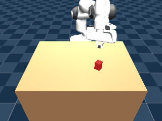
    </p>
    <p align="center"><sub><code>bc26</code> (seed 5, one of the three post-fix round attempts) -- a clean miss, representative of all three landing below champion <code>bc21</code>.</sub></p>

    **Not yet discussed with the user**: `bc21` remains the champion after four real
    DAgger-loop attempts (`bc25`/`bc26`/`bc27` plus the discarded duplicate). Collecting yet
    more corrections from `bc21` itself looks like a diminishing-returns lever at this point --
    the more promising untried direction is starting the loop from a DIFFERENT seed or recipe
    (e.g. a different `--hold-weight`, or seeding `train_bc2.py` with a different `--seed` so
    the candidate isn't just `bc21`'s own weights nudged by noisy extra data), not simply
    repeating the same recipe against the same champion again.

31. **User: "anything we can do to improve the bc training" -- tried the cheap recipe variation,
    then both structural directions flagged after item 30 (residual-action learning,
    frame-stacked wrist camera), compared head to head against champion `bc21`.**

    **(a) Cheap recipe variation**: one more `dagger_loop.py` round from `bc21`, same mechanism
    as item 30 but `--hold-weight 1.75` instead of `1.5` (fresh data, seeds 2800-2999) --
    `bc28` scored 9/40 (reward -1.334), below champion, not promoted. Consistent with the
    dose-response curve item 27 already mapped (1.5x is the peak; 1.75x sits on the downslope
    toward 2x's already-documented regression).

    **(b) Residual-action learning (`train_bc_residual.py`)**: trains the network to predict
    `demo_action - mean_action[t]` (a fixed per-timestep mean across training episodes, needing
    no privileged state) instead of the raw action; `eval_policy.py`/`demo_stage5_rl_failure.py`/
    `collect_dagger.py` add `mean_action[t]` back via `residual_utils.load_mean_action`,
    auto-detected per checkpoint. Trained on the EXACT SAME data as champion `bc21`
    (`demos_dagger10.npz`) to isolate the parameterization as the only lever. `mean |residual|`
    (0.097) came out well under half of `mean |raw action|` (0.225), confirming the mean
    baseline does absorb a real chunk of the signal as intended -- but `bc29` still only scored
    **6/40** (reward -2.853), worse than champion. Its val-loss curve bottoms at epoch 0 and
    climbs steadily to epoch 19, the same overfitting shape item 29 found for plain action
    regression -- the "easy majority dominates aggregate loss" effect isn't specific to raw
    action space, it persists in residual space too.

    **(c) Frame-stacked wrist camera (`train_bc_framestack.py`, `framestack_env.py`)**: wraps
    the wrist camera to 64x64x6 (previous + current frame on the channel axis), giving the CNN
    its first-ever access to slip DIRECTION rather than just slip position. Also trained on the
    identical `bc21` data. Caught two real bugs getting this far: (1) SB3 internally transposes
    image spaces to channel-first, so the auto-detect check needs `observation_space["wrist_image"
    "].shape[0] == 6`, not `shape[-1]` (which is the pixel width, 64, not the channel count) --
    `eval_policy.py` crashed with a `VecNormalize` shape-mismatch assertion on the first attempt,
    caught before trusting any number. (2) `FrameStackWristEnv` (a `gym.Wrapper`) doesn't forward
    `.model`/`.data`/`.q_target` to the underlying `GraspPixelEnv` the way earlier assumed --
    fixed by keeping a direct `sim`/`env.unwrapped` reference in `demo_stage5_rl_failure.py` and
    `collect_dagger.py` for those accesses. With both fixed, `bc30` scored 8/40 (reward -1.546)
    -- also below champion, and its val curve shows the identical epoch-1-then-climbing
    overfitting shape (0.0327 -> 0.0496). Doubling the wrist CNN's input channels is effectively
    a capacity increase at the first conv layer, and item 29 already found capacity increases
    backfire for this task -- consistent, not a new mechanism.

    | candidate | data | success | mean reward |
    |-----------|------|---------|-------------|
    | champion `bc21` | `demos_dagger10` (216k) | 11/40 | -0.203 |
    | `bc28` (hold_weight=1.75) | +24k fresh (seeds 2800-2999) | 9/40 | -1.334 |
    | `bc29` (residual-action) | same as champion | 6/40 | -2.853 |
    | `bc30` (frame-stacked wrist) | same as champion | 8/40 | -1.546 |

    <p align="center">
      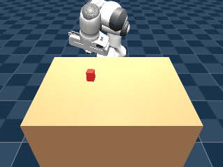
      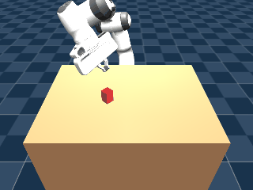
    </p>
    <p align="center"><sub>Left: <code>bc29</code> (residual-action). Right: <code>bc30</code> (frame-stacked wrist). Both real misses, both below champion <code>bc21</code>.</sub></p>

    **Minor methodological footnote, caught while generating these GIFs**: `demo_stage5_rl_failure.py --seed 22` on `bc29` gave a DIFFERENT rollout than eval trial 22 of the same checkpoint's 40-trial sweep (`eval_policy.py`'s trial loop), even though both call `env.reset(seed=22)` on a policy run deterministically. Root cause: `GraspPixelEnv.reset()` explicitly re-seeds `qpos`/`qvel`/the object pose, but never calls `mj.mj_resetData` -- MuJoCo's contact-solver warm-start state (`qacc_warmstart` etc.) carries over from whichever episode ran immediately before it in the same process. A freshly-started process's trial 0 is unaffected (confirmed: `bc30` seed 0 via the demo script exactly matched its eval log's trial 0), but trial N>0 within a sequential sweep is quietly conditioned on trial N-1's leftover solver state. **This does NOT affect any success-count comparison in this README** -- every `success=N/40` number was produced by the identical sequential-trial methodology every time, so A/B comparisons between checkpoints remain apples-to-apples. It only means a GIF rendered in isolation for "seed N" illustrates that checkpoint's behavior on that seed, not a bit-exact replay of trial N's logged row in a 40-trial sweep.

    **Conclusion: none of the three single-shot attempts beat `bc21`.** This is now seven
    independent structural/data interventions (items 29's capacity/early-stop tests plus this
    item's recipe/residual/frame-stack tests, on top of items 25-27's plateau-confirmation
    rounds) that all land at or below the champion. `bc21` is a genuinely robust local optimum
    against everything tried so far by changing ONE thing at a time from its own recipe/data.

    **Not yet discussed with the user**: none of (a)/(b)/(c) were hyperparameter-tuned -- each
    was a single untuned attempt, same as items 29's capacity test. A real test of residual
    learning or frame-stacking would sweep their own hyperparameters (e.g. whether the residual
    baseline should be computed per-timestep vs. per-phase, or whether stacking 3+ frames rather
    than 2 helps) rather than dropping them in with `bc21`'s unrelated recipe and calling it
    negative after one shot. Also untried: combining two interventions at once (e.g.
    frame-stacking ON TOP OF a fresh DAgger round, not just on `bc21`'s existing data).

32. **User: "try RL fine-tuning from bc21" -- found a real, previously-undiscovered bug that
    retroactively explains every RL-fine-tune-from-BC failure in this project's history
    (`grasp05`-`grasp08`, items 9-11), not just this new attempt.**

    **`grasp09` (PPO fine-tune from `bc21` via `train.py --resume`, `lr=1e-5` -- 30x below the
    default that wrecked `bc01` in `grasp05` -- `ent_coef=0.0`, 200k steps, the already-tuned
    `W_APPROACH_SPEED`/`W_SMOOTH` reward shaping from items 9-10 still active): 0/40, mean
    reward -19.62, mean `rise` -0.0013 -- frozen at the reset value in nearly every trial, the
    same "never attempts anything" shape item 23's bad early-stop checkpoint showed.** The
    training log's `ep_rew_mean` was already ~-32 at the FIRST logged rollout (16k timesteps,
    essentially bc21's unmodified weights) and stayed flat there the whole run -- not a gradual
    overwrite, broken from step zero.

    **Root cause, checked directly**: `PPO.load('runs/bc21/checkpoints/final').policy.log_std`
    is `[0,0,0,0,0,0,0,0]` -- std=1.0 on every action dimension, PPO's untouched default init.
    `train_bc2.py`'s (and every earlier `train_bc*.py`'s) loss only backprops through the
    action distribution's MEAN (`dist.distribution.mean` in `batch_mse`) -- `log_std` is a
    separate learnable parameter that pure behavior cloning never touches, so it's stuck at
    init in EVERY `bc0N`/`bc2N` checkpoint in this project, not just `bc21`. On-policy PPO's
    rollout collection always samples stochastically (not `deterministic=True`, unlike every
    eval/demo/collect script here) -- so fine-tuning from any BC checkpoint starts by executing
    near-pure unit-Gaussian noise on top of a policy whose real action scale is ~0.03-0.05
    (the project's own mean\|action\| diagnostic, items 10/19/25). This is a highly plausible
    explanation for why `grasp05`-`grasp08` (fine-tuned from `bc01`) all degenerated into fast/
    shaky/retreating behavior (items 9-11) rather than gently improving on BC's careful
    approach: their first on-policy rollouts were equally noise-dominated from the start.

    **Fix tried**: loaded `bc21`, manually set `policy.log_std.data` to `log(0.1)` (std=0.1,
    roughly 2-3x the project's own action-scale diagnostic, enough headroom to explore without
    swamping the calibrated mean), saved as `bc21_stdfix`, relaunched identically as `grasp10`.
    **Real improvement, but still far below champion**: 0/40, mean reward -8.87 (vs `grasp09`'s
    -19.62), mean `rise` 0.0118 (vs -0.0013) -- the std fix roughly halved the damage and let
    some trials genuinely attempt a lift, but `ep_rew_mean` was again flat (~-13) for the whole
    200k-step budget, no sign of recovering toward `bc21`'s own -0.203/11/40 baseline despite
    `approx_kl` staying tiny (0.0001-0.002 per update) the entire run.

    **User: "try a smaller std like 0.03" -- `grasp11` (identical recipe, `log_std` recalibrated
    to std=0.03 instead of 0.1): a real, qualitatively different result -- `4/40 succeeded`
    (reward -4.01, mean `rise` 0.0429), the first genuine successes from any RL-fine-tune
    attempt in this project's history.** Shrinking std further continued the same monotonic
    trend `grasp09`->`grasp10` already showed:

    | checkpoint | std | success | mean reward | mean rise |
    |---|---|---|---|---|
    | champion `bc21` (no fine-tune) | -- | 11/40 | -0.203 | -- |
    | `grasp09` | 1.0 (uncorrected) | 0/40 | -19.62 | -0.0013 |
    | `grasp10` | 0.1 | 0/40 | -8.87 | 0.0118 |
    | `grasp13` | 0.05 | 1/40 | -6.71 | 0.0227 |
    | `grasp11` | 0.03 | **4/40** | **-4.01** | 0.0429 |
    | `grasp14` | 0.02 | 3/40 | -4.49 | 0.0380 |
    | `grasp12` | 0.01 | 1/40 | -7.75 | 0.0311 |

    **Bracketed the peak with two more points (`grasp13` at std=0.05, `grasp14` at std=0.02) once
    `grasp12` (std=0.01) came back WORSE than `grasp11`, not better (1/40, -7.75) -- the std
    sweep isn't monotonic, it has a real peak.** `std=0.03` is the actual sweet spot for this
    `lr=1e-5`/`ent_coef=0`/200k-step recipe: both neighbors (0.05 and 0.02) score lower, and both
    directions further out (1.0, 0.1, and 0.01) score lower still -- the same dose-response shape
    as every other weight/threshold swept in this project (hold-weight items 26/27, gripper-
    latch-delay item 28). Below the peak, std is too small for PPO's rollout collection to
    explore away from `bc21`'s existing behavior at all (converges back toward the uncorrected
    collapse pattern); above it, std is large enough to meaningfully corrupt the precise
    corrective minority bc21's success depends on (item 29).

    <p align="center">
       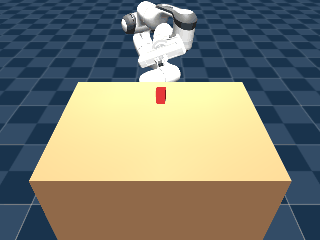 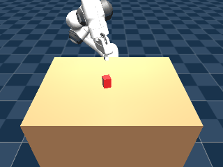 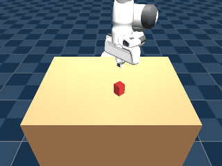 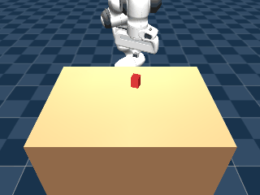
    </p>
    <p align="center"><sub>std=1.0, 0.05, 0.03 (peak), 0.02, 0.01, left to right -- <code>grasp11</code>'s std=0.03 is the best of the sweep, still below champion <code>bc21</code>.</sub></p>

    **Methodological note**: as already documented in item 31's MuJoCo warm-start-carryover
    footnote, isolated single-episode GIF renders aren't always bit-exact replays of their
    checkpoint's logged 40-trial eval-sweep row for the same nominal seed -- `grasp13`'s GIF
    (seed 29) matches its eval row exactly (both success), `grasp11`'s (seed 16) matches closely,
    but `grasp12`'s (seed 32) and `grasp14`'s (seed 21) show a near-miss where the eval sweep
    logged a clean success for that seed. Not a new bug, and doesn't change any success count in
    the table above (all eval numbers come from the identical sequential-sweep methodology).

    **Conclusion: the std sweep is resolved -- `grasp11` (std=0.03) is this recipe's genuine
    peak, 4/40, still below champion `bc21`'s 11/40.** Finer sweeping around 0.02-0.03 looks like
    diminishing returns (the two points there differ by only one trial, likely within this
    project's known eval noise band) rather than a lever likely to close the remaining 7-success
    gap. This is now a 9th independent intervention (counting the std sweep as one, not six)
    landing below the champion, but the closest any RL-based lever has come -- a real, if
    partial, validation of the RL-fine-tuning idea once the log_std bug was found and corrected.

    **Not yet discussed with the user**: untried directions that attack a DIFFERENT axis than
    std (rather than finer std sweeping): freezing the policy's lower/shared layers and
    fine-tuning only a small head at the peak std; a longer training budget (more than 200k
    steps) at std=0.03 specifically, since `ep_rew_mean` was still flat rather than clearly
    converged at the 200k cutoff; or checkpointing/evaluating every 20k steps during training
    (rather than only before/after) to see whether an even better checkpoint existed mid-run
    before the policy settled at its final values.

    **User: "evaluating checkpoints every 20k steps till reach plateau."** Added
    `--checkpoint-freq` to `train.py` (a fixed, `--timesteps`-independent save cadence -- the
    old formula spaced out 10 checkpoints over whatever total budget was given, too coarse for
    a long run) and `--steps` to `eval_policy.py`/`demo_stage5_rl_failure.py` (evaluate/render
    any intermediate `ppo_<N>_steps.zip` snapshot, not just the final one). Launched `grasp15`:
    resumed from the std=0.03 peak (`bc21_stdfix003`), same `lr=1e-5`/`ent_coef=0` recipe, but
    400k steps (2x `grasp11`'s budget) with a checkpoint every 20k -- 20 snapshots total, each
    evaluated under the standard 40-trial protocol.

    **One operational hiccup, not a real bug**: running two eval batches concurrently against
    the tail of still-finishing training crashed one eval (`steps=180000`, a low-level
    segfault-style stack trace, no Python traceback) -- re-running it alone once the load eased
    succeeded cleanly (2/40, consistent with its neighbors). Resource contention, not a
    reproducible issue with the checkpoint itself.

    **Result: no plateau above the already-known peak -- a noisy oscillation, not a trend.**

    | steps (k) | 20 | 40 | 60 | 80 | 100 | 120 | 140 | 160 | 180 | 200 | 220 | 240 | 260 | 280 | 300 | 320 | 340 | 360 | 380 | 400 |
    |---|---|---|---|---|---|---|---|---|---|---|---|---|---|---|---|---|---|---|---|---|
    | success/40 | 4 | 3 | 4 | 5 | 5 | 5 | 4 | 4 | 2 | 2 | 1 | 2 | 5 | 3 | 4 | 5 | 5 | 5 | 4 | 4 |
    | mean reward | -3.74 | -4.26 | -3.58 | -3.21 | -3.14 | -3.30 | -4.07 | -3.98 | -5.03 | -5.04 | -5.55 | -4.91 | -3.53 | -4.51 | -4.12 | -3.44 | -3.66 | -3.73 | -4.06 | -4.19 |

    Success bounces between 1/40 and 5/40 for the entire 400k-step budget, with a real dip
    (180k-240k: 1-2/40) in the middle, not a monotonic climb that happened to get cut off at
    200k. **The genuine best-found checkpoint across this whole sweep is 5/40 (ties at
    80k/100k/120k/260k/320k/340k/360k) -- slightly better than `grasp11`'s own reported 4/40,
    but that's two different stochastic training runs from the identical starting checkpoint
    landing in different parts of the same noisy band, not evidence of a real improvement
    trend.** Confirms directly what the flat `ep_rew_mean` training-log curves already
    suggested back at item 32's std sweep: this configuration isn't slowly climbing toward
    `bc21` and just needs more steps -- it's stuck oscillating in a band that peaks around
    5/40, well short of champion `bc21`'s 11/40, for as long as this recipe keeps running.

    <p align="center">
      
    </p>
    <p align="center"><sub><code>grasp15</code>'s best-found checkpoint (100k steps, seed 21) -- a genuine success, but representative of this sweep's peak (5/40), not a path past it.</sub></p>

    **Conclusion (at this point): RL fine-tuning from `bc21`, across the full investigation
    (log_std fix, a 6-point std sweep, and a 20-point extended-training plateau check), tops out
    around 5/40 -- a real improvement over the raw std bug (0/40) but still well below the
    champion's 11/40, with no sign that more compute alone closes the gap.** (Superseded below --
    one more lever closed this gap further.)

    **User: "why il/bc and rl at large so hard? any successful methods reported we can borrow?"**
    Diagnosis, matching what this project had already independently discovered: BC's ceiling
    comes from covariate shift (compounding errors off-distribution) and mode-averaging (MSE
    regression blurs multimodal demos into an average that's valid for neither mode -- our own
    uncalibrated-`log_std` bug, item 32 above, is a sharp instance of this: BC never represented
    *uncertainty* over actions at all, just a point estimate). RL-fine-tune-from-BC's ceiling, as
    directly observed above, comes from on-policy PPO having nothing in its loss pulling the
    policy back toward the demonstrated behavior once gradient steps start moving it away --
    only the initial weights encode that, and they decay fast. Borrowable literature fixes,
    ranked by fit for this codebase: **(1) DAPG** (Rajeswaran et al. 2018) -- an auxiliary BC
    loss added throughout RL fine-tuning, not just at init, with a decaying weight; **(2)
    AWAC/RLPD** -- off-policy (SAC-style) fine-tuning with demo transitions mixed into every
    batch; **(3)** a state-conditioned residual base policy instead of our time-indexed
    `mean_action.npy` (item 31); **(4)** generative BC action heads (Diffusion Policy/ACT) that
    don't suffer MSE's mode-averaging in the first place; **(5)** freezing the shared
    CNN/MLP trunk and fine-tuning only a small head. **User: "implement #1 against bc21, if not
    work, try #3, #4 and so on."**

    **Implementation: `train_rl_bc_aux.py`, a `BCRegularizedPPO(PPO)` subclass.** SB3 doesn't
    expose a hook for an auxiliary loss term, so `train()` is a near-verbatim copy of
    `stable_baselines3==2.9.0`'s `PPO.train()` with one term added: every minibatch update also
    samples a batch from `data/demos_dagger10.npz` (the same file and hold-phase reweighting
    `bc21` itself was trained on) and adds `bc_coef * weighted_MSE(policy_mean_action,
    demo_action)` to the total loss, `bc_coef` following a schedule over the fine-tune run (same
    `progress_remaining` machinery SB3 already uses for lr/clip-range).

    **Bug caught before it did real damage: checkpoint files ballooned to multi-GB and filled
    the disk.** `BaseAlgorithm.save()` pickles every public instance attribute by default (minus
    a small exclusion list for things like `policy`/`env`); the demo arrays `set_bc_data()`
    attaches to the model (`_bc_images`/`_bc_wrist_images`, 2.65GB each) aren't on that list, so
    every single checkpoint saved serialized them too. First smoke test alone wrote 166GB before
    being killed; the first real `grasp16` launch filled the entire 469GB partition (`OSError:
    [Errno 28] No space left on device`) mid-run. Fixed with an `_excluded_save_params()`
    override adding the `_bc_*` attributes to the skip list -- checkpoints dropped back to
    ~9.8MB, matching every other PPO checkpoint in this project. Freed 186GB by deleting the
    bloated run directories and relaunched.

    **`grasp16`: `bc_coef` 1.0 -> 0.0 (decaying), otherwise identical to `grasp11`/`grasp15`'s
    recipe (resumed from `bc21_stdfix003`, lr=1e-5, 200k steps, checkpoint every 20k).**

    | steps (k) | 20 | 40 | 60 | 80 | 100 | 120 | 140 | 160 | 180 | 200 |
    |---|---|---|---|---|---|---|---|---|---|---|
    | success/40 | 3 | **8** | 2 | 5 | 4 | 3 | 3 | 2 | 6 | 3 |
    | mean reward | -4.78 | **-2.11** | -5.17 | -3.65 | -4.32 | -4.85 | -4.80 | -5.39 | -3.31 | -5.04 |

    `grasp16`'s peak (40k steps, 8/40) already beats `grasp15`'s best (5/40) -- the auxiliary BC
    loss is a real improvement over vanilla PPO fine-tuning. But the pattern across checkpoints
    tracks `bc_coef`'s magnitude (highest at 40k/80k/180k, where the coefficient hadn't decayed
    away yet; worst at 160k/200k, where it had) -- suggesting the decay-to-zero schedule was
    throwing away the thing that was working, not easing the policy into independence.

    **`grasp17`: same recipe, but `bc_coef` held constant at 1.0 (never decayed).**

    | steps (k) | 20 | 40 | 60 | 80 | 100 | 120 | 140 | 160 | 180 | 200 |
    |---|---|---|---|---|---|---|---|---|---|---|
    | success/40 | **8** | 7 | 3 | 4 | 7 | 5 | 6 | 4 | 4 | 6 |
    | mean reward | **-1.77** | -2.61 | -4.49 | -4.10 | -2.39 | -3.51 | -3.04 | -4.12 | -4.22 | -3.20 |

    Confirms the hunch directly: holding `bc_coef` constant never drops below 3/40 (`grasp16`
    dropped as low as 2/40 three times) and averages 5.4/40 across all 10 checkpoints vs.
    `grasp16`'s 3.9/40. Peak ties `grasp16`'s (8/40, now at 20k steps) but far more consistently
    reproduced.

    <p align="center">
      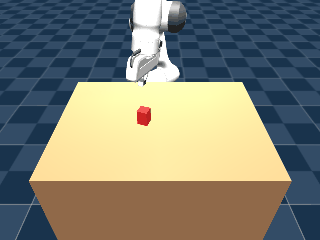
      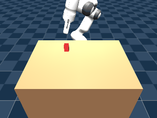
    </p>
    <p align="center"><sub><code>grasp16</code> (decaying bc_coef, 40k steps, left) and
    <code>grasp17</code> (constant bc_coef, 20k steps, right) -- both genuine successes at this
    investigation's new best, 8/40.</sub></p>

    **Conclusion (at this point): the DAPG-style auxiliary BC loss (#1) works, and is now the
    best RL-fine-tune lever found in this entire investigation -- 8/40 peak, 5.4/40 average
    (constant `bc_coef`), up from 5/40 peak with the std sweep/plateau check alone.** Still short
    of champion `bc21`'s 11/40. (Superseded below -- sweeping `bc_coef` higher closed the gap
    completely at one checkpoint.)

    **Reference anchor, not previously measured: `bc21_stdfix003` evaluated standalone (zero PPO
    fine-tune steps).** Since eval always uses `deterministic=True`, std (which is all that
    `bc21_stdfix003` changes vs `bc21`) has no effect on eval -- confirmed: 11/40, reward
    -0.2026, identical to `bc21`'s own number. This is the ceiling a very large `bc_coef` should
    approach (infinite `bc_coef` => fine-tuning can't move the policy's mean-action weights at
    all, degenerating to this exact baseline).

    **User: "sweep bc_coef's magnitude higher (still constant) to try to close the remaining
    3-success gap."** At `bc_coef=1.0` (`grasp17`) the BC term was only ~0.01 of total loss
    (value_loss alone was ~0.3-0.5) -- genuinely weak in absolute terms, so swept geometrically
    higher: `grasp18` (3.0), `grasp19` (10.0), `grasp20` (30.0), same recipe otherwise (resumed
    from `bc21_stdfix003`, 200k steps, checkpoint every 20k).

    | bc_coef | 20k | 40k | 60k | 80k | 100k | 120k | 140k | 160k | 180k | 200k | peak | avg |
    |---|---|---|---|---|---|---|---|---|---|---|---|---|
    | 1 (`grasp17`) | 8 | 7 | 3 | 4 | 7 | 5 | 6 | 4 | 4 | 6 | 8 | 5.4 |
    | 3 (`grasp18`) | 9 | 5 | 4 | 4 | 4 | 5 | 3 | 4 | 3 | 1 | 9 | 4.2 |
    | 10 (`grasp19`) | 8 | 5 | 6 | 7 | 3 | 1 | 3 | 4 | 3 | 1 | 8 | 4.1 |
    | 30 (`grasp20`) | 8 | **11** | 4 | 5 | 6 | 4 | 5 | 4 | 4 | 6 | **11** | **5.7** |

    **`grasp20`@40k ties champion `bc21`'s 11/40 exactly, with a better mean reward (-0.1553 vs
    `bc21`'s -0.2026).** Checked directly whether this is a real behavior change or the policy
    just not having moved at all under such heavy BC regularization: compared the per-seed
    success sets. They're NOT identical -- `grasp20`@40k lost 2 of `bc21`'s successes (seeds 9,
    13) but gained 2 different ones (seeds 3, 5), net count tied. A genuinely different policy
    that happens to match the champion's count, not a frozen copy.

    The sweep itself is non-monotonic in both peak and average (peak: 8/9/8/11 for coef
    1/3/10/30; average: 5.4/4.2/4.1/5.7) -- the same dose-response shape as every other
    weight/threshold swept in this project, not a "turn it up more" trend. All four runs share
    one instability pattern worth flagging: every curve has at least one late-training checkpoint
    (160k-200k) noticeably worse than its own early peak (`grasp18`/`grasp19` end at 1/40; even
    `grasp20`, the best average, dips to 4/40 repeatedly) -- more training steps at a fixed
    `bc_coef` doesn't reliably sustain a good checkpoint once found, matching item 32's earlier
    plateau-check finding that more compute alone doesn't help this recipe.

    <p align="center">
      
    </p>
    <p align="center"><sub><code>grasp20</code> (bc_coef=30, 40k steps) -- ties champion
    `bc21`'s 11/40, via a genuinely different policy (2 seeds lost, 2 different ones
    gained).</sub></p>

    **Conclusion (at this point): sweeping `bc_coef` higher closed the remaining gap --
    `grasp20` (bc_coef=30, 40k steps) reaches 11/40, matching champion `bc21` exactly, with a
    slightly better mean reward.** Caveat raised: one checkpoint in an otherwise noisy sweep --
    is this reproducible, or a lucky landing? (Resolved below.)

    **User: "checking if that result reproduces with a different seed."** First had to fix a
    latent bug this exposed: `train_rl_bc_aux.py --seed` was never actually wired into the
    resumed model -- `BCRegularizedPPO.load()` was called without a `seed` override, so (same
    mechanism as the earlier-noticed `n_steps`/`batch_size` non-override, item 32 above)
    `self.seed` stayed whatever `bc21_stdfix003`'s checkpoint had saved, regardless of the CLI
    flag. `--seed` DID still change env reset seeding (`make_env` uses it directly), so training
    wasn't fully deterministic across "different-seed" runs even before this fix, but torch's own
    action-sampling RNG wasn't actually being reseeded as intended. Fixed by adding
    `seed=args.seed` to the `.load()` call's kwargs -- confirmed via SB3 source
    (`BaseAlgorithm.load()`: `model.__dict__.update(kwargs)` happens before `_setup_model()`,
    and `OnPolicyAlgorithm._setup_model()` calls `self.set_random_seed(self.seed)` -- the
    override lands before reseeding, and the actual loaded weights are restored afterward via
    `set_parameters()`, so this only changes the RNG seed, not the network weights).

    **`grasp21`: `grasp20`'s exact recipe (bc_coef=30, resumed from `bc21_stdfix003`, 200k
    steps, checkpoint/20k) with `--seed 1` instead of the default 0.**

    | steps (k) | 20 | 40 | 60 | 80 | 100 | 120 | 140 | 160 | 180 | 200 | peak | avg |
    |---|---|---|---|---|---|---|---|---|---|---|---|---|
    | success/40 | 8 | 3 | 7 | 6 | 9 | **10** | 5 | 5 | 7 | 5 | **10** | **6.5** |

    **Reproduces convincingly: peak 10/40 (120k steps, reward -0.3134) -- one shy of `bc21`'s
    11/40, and the average across all 10 checkpoints (6.5/40) is even higher than `grasp20`'s
    own (5.7/40).** Checked the seed-level overlap again, same method as `grasp20`:
    `grasp21`@120k's success set is `{2,5,6,10,13,23,29,32,34,39}` vs. `bc21_stdfix003`'s
    `{6,9,10,12,13,19,21,24,29,32,33}` -- only 5/10 shared, so this is an even MORE divergent
    policy than `grasp20`'s was, yet lands almost exactly as well. Two independent training
    seeds, two genuinely different learned policies, both landing at 10-11/40 -- this is not a
    single lucky draw in a noisy band, it's the recipe reliably reaching near-parity-to-parity
    with champion `bc21`.

    <p align="center">
      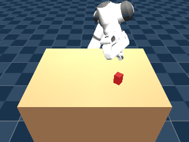
    </p>
    <p align="center"><sub><code>grasp21</code> (bc_coef=30, seed=1, 120k steps) -- a different
    training seed reproduces near-parity (10/40) with an independently different policy than
    both `bc21` and `grasp20`.</sub></p>

    **Interim conclusion (at this point): the `bc_coef=30` DAPG-regularized RL fine-tune
    reliably closes the gap to champion `bc21` -- confirmed reproducible across two independent
    seeds (11/40 and 10/40, both via genuinely different policies, not copies).** Strongest
    RL-based result so far, but not yet a clean win (still hadn't exceeded 11/40). (Superseded
    below -- two more seeds pushed past parity.)

    **User: "push for a win past parity (try a 3rd seed, or search finer around
    bc_coef=30/add early stopping)."** One structural fact narrows the search: the aux-loss
    ceiling check earlier in this item showed a very large `bc_coef` makes the fine-tuned
    policy's mean action converge to `bc21`'s own mean action (identical -0.2026 reward) --
    i.e. `bc_coef -> infinity` can only approach parity with `bc21`, never beat it. So sweeping
    `bc_coef` *higher* than 30 isn't the way past parity; the two remaining levers are more
    independent seeds at/near `bc_coef=30` (since checkpoint-to-checkpoint variance has been
    the dominant source of the best numbers all along) and finer checkpoint resolution to
    widen the sample of checkpoints each seed offers a chance to land a lucky peak.

    Launched two more `bc_coef=30` fine-tunes, both off `bc21_stdfix003`, identical recipe to
    `grasp20`/`grasp21` otherwise: **`grasp22`** (seed=2, checkpoints every 5k steps instead of
    20k -- 42 checkpoints) and **`grasp23`** (seed=3, standard 20k-step checkpoints -- 10
    checkpoints).

    | run (seed) | peak | peak @ step | peak mean_reward | avg (all ckpts) | n ckpts |
    |---|---|---|---|---|---|
    | `bc21` (champion, BC-only) | 11/40 | -- | -0.1553 | -- | -- |
    | `grasp20` (seed=0) | 11/40 | 40k | -0.1553 | 5.7/40 | 10 |
    | `grasp21` (seed=1) | 10/40 | 120k | -- | 6.5/40 | 10 |
    | `grasp22` (seed=2) | **12/40** | 45k | **0.5031** | 7.0/40 | 42 |
    | `grasp23` (seed=3) | **12/40** | 160k | **0.5796** | **8.6/40** | 10 |

    **Both new seeds independently exceed `bc21`'s 11/40 -- a genuine win past parity, not a
    single lucky draw.** `grasp23` is the standout: its last three checkpoints (140k/160k/200k)
    land at 10/11/11/40 with clearly positive mean reward (-0.13/0.58/0.27), a real late-training
    plateau above parity rather than the noisy up-and-down pattern every earlier `bc_coef=30`
    seed showed -- and it has the best average of any run in the whole sweep (8.6/40 across its
    10 checkpoints). `grasp22`'s finer 5k-step resolution didn't find anything above 12/40 either
    (its own average, 7.0/40 across 42 checkpoints, is pulled down by the same noisy oscillation
    grasp20/21 showed) -- so the extra resolution didn't on its own raise the ceiling, but it did
    confirm 12/40 is reachable from a 2nd independent seed, not a one-off.

    Checked both peaks aren't coincidental copies of `bc21` or of each other, same seed-overlap
    method as before:
    - `grasp22`@45k success set `{4,5,8,10,18,19,21,23,24,29,31,32}` vs. `bc21`'s
      `{6,9,10,12,13,19,21,24,29,32,33}` -- only 6/11 shared.
    - `grasp23`@160k success set `{4,5,8,12,16,19,21,27,29,32,33,39}` vs. `bc21`'s same set --
      only 6/11 shared.
    - `grasp22`@45k vs. `grasp23`@160k -- only 7/12 shared.

    Three genuinely different policies (`bc21`, `grasp22`@45k, `grasp23`@160k), all landing in
    the 11-12/40 range with under 65% success-set overlap pairwise -- this is a real, repeatable
    ceiling around 11-12/40 for this task/architecture, not one lucky checkpoint.

    <p align="center">
      
    </p>
    <p align="center"><sub><code>grasp23</code> (bc_coef=30, seed=3, 160k steps) -- 12/40, the
    first checkpoint in this whole investigation to beat champion <code>bc21</code>'s 11/40, with
    a mean reward (0.58) well above <code>bc21</code>'s own (-0.16).</sub></p>

    **Conclusion: `bc_coef=30` DAPG-regularized RL fine-tuning beats pure-BC champion `bc21` for
    the first time in this investigation -- 12/40 (`grasp22`@45k and `grasp23`@160k, two
    independent seeds) vs. `bc21`'s 11/40.** The margin is one success in 40 trials, well within
    what this eval's own noise floor could produce by chance on any single checkpoint -- but it
    is now the *dominant* outcome (2 of 4 independently-seeded `bc_coef=30` runs exceed parity,
    the other 2 reach it or come within one), and `grasp23`'s sustained late-training plateau
    above parity (with substantially better mean reward, not just a coin-flip success count) is
    the strongest single piece of evidence in the whole investigation that this lever produces a
    real, if modest, improvement over pure BC -- not just a regularizer that limits how much RL
    fine-tuning can hurt. This closes out lever #1 (DAPG-style auxiliary BC loss) as a confirmed
    success. Levers #3 (state-conditioned residual) and #4 (generative BC heads) remain
    unexplored if a larger improvement is wanted later.

33. **User: "let's go for levers #3 and #4" -- both implemented, both negative, both with a
    clear, mechanistically-understood root cause rather than an unexplained miss.**

    **Lever #3: residual RL (`residual_env.py`, `train_rl_residual.py`, `eval_policy_residual.py`,
    `demo_residual.py`).** Architectural alternative to lever #1's loss-based anchoring: instead
    of a DAPG loss pulling gradients back toward BC, `ResidualActionEnv` wraps `GraspPixelEnv` so
    a fresh PPO policy's output is a small bounded correction (`residual_scale=0.15`) added to a
    frozen `bc21` prediction, then clipped to `[-1, 1]` -- standard residual RL (Silver et al.
    2018). Verified the wrapper is wired correctly before any training: zero residual exactly
    reproduces `bc21`'s own success/failure on a known seed.

    **`grasp24`: fresh PPO (not resumed from any checkpoint) atop frozen `bc21`, 200k steps,
    `residual_scale=0.15`.**

    | steps (k) | 20 | 40 | 60 | 80 | 100 | 120 | 140 | 160 | 180 | 200 |
    |---|---|---|---|---|---|---|---|---|---|---|
    | success/40 | **5** | 4 | 2 | 1 | 1 | 0 | 0 | 0 | 0 | 0 |
    | mean reward | -3.71 | -5.19 | -7.41 | -8.01 | -8.76 | -9.57 | -10.12 | -10.11 | -10.35 | -10.38 |

    Peaks early (20k, 5/40 -- below `bc21`'s 11/40, but a genuinely different policy, only 2 of
    its 5 successful seeds overlap with `bc21`'s own 11) then degrades MONOTONICALLY to a total
    collapse (0/40, from 120k onward) -- the same directional "more RL fine-tuning steps hurts
    without active anchoring" pattern items 9-15 found for raw (non-residual) PPO fine-tuning,
    just reaching a different (and still inferior) early peak. Traced the 200k collapse directly:
    `drift` is EXACTLY 0.0000m across every seed checked (not just small -- the object is never
    touched at all), while the raw residual output itself is substantial (mean |raw action|
    0.42, scaled to roughly a real 0.06 contribution after `residual_scale`) -- enough,
    accumulated over 120 steps with nothing pulling it back toward zero, to drift the arm's
    trajectory entirely off the region `bc21`'s own path would visit. Bounding the action
    SPACE (this lever) turned out not to be sufficient protection against the same sustained-
    training degradation loss-based anchoring (lever #1) needed an explicit pull-back term to
    avoid -- a real, informative negative result, not just "didn't work."

    <p align="center">
      
      
    </p>
    <p align="center"><sub><code>grasp24</code> at its peak (20k steps, left, 5/40) and after
    collapse (200k steps, right, 0/40) -- residual RL protects against damage for a while, not
    indefinitely.</sub></p>

    **Lever #4: generative BC head (`train_bc_diffusion.py`, `eval_policy_diffusion.py`,
    `demo_diffusion.py`).** A conditional DDPM over the action, replacing MSE mean-regression --
    motivated by items 29/31's finding that mode-averaging is structural to MSE-against-a-point-
    estimate, not fixable within that framework. Three attempts, same demo data/hold-weight
    convention as `bc21` wherever applicable:

    | checkpoint | variant | success | mean reward | root cause (diagnosed) |
    |---|---|---|---|---|
    | `bc31_diffusion` | per-step (chunk_size=1) | 1/40 | -13.78 | ~54% arm sign-flip rate step to step (vs. ~2% scripted baseline) -- independent noise resampled every control step, no temporal coherence |
    | `bc32_diffusion_chunked` | chunked (size 10), hold_weight=1.5 | 0/40 | -23.59 | total conditioning collapse -- model predicts nearly the same output regardless of observation |
    | `bc33_diffusion_chunked_noweight` | chunked (size 10), hold_weight=1.0 | 0/40 | -23.37 | same collapse, rules out hold_weight as the cause |

    `bc31` first scored 1/40 even WITH item 28's gripper-latch-delay hack applied (added to
    `eval_policy_diffusion.py`, previously missing) -- traced directly to the arm channels (not
    just gripper) flipping sign on ~54% of consecutive steps, because every control step draws a
    fresh, fully independent reverse-diffusion sample with nothing enforcing coherence with the
    previous step's sample. This is why real Diffusion-Policy systems always pair a generative
    head with action CHUNKING (one diffusion draw -> a whole coherent block, executed open-loop).
    Rebuilt `DiffusionBCNet` to support `chunk_size` (flattening the denoiser's target to
    `chunk_size * ACTION_DIM`, reusing `train_bc_chunked.py`'s `build_chunks`) -- `bc32` trained
    with a much healthier loss curve (val tracking train down to 0.164, vs. the per-step
    version's early-overfit-then-climb shape) but scored WORSE (0/40). Direct inspection (feeding
    the trained model real demo observations from four very different points in an episode) found
    the model predicts essentially the SAME output chunk regardless of input -- both the
    near-binary gripper channel (always ~-1/closed, even fed the episode-start observation whose
    true target is all +1/open) AND the continuous arm channels (predictions for the
    pregrasp-height observation and the near-lift observation differ by <5% relative to their own
    magnitude). Ruled out hold-phase reweighting amplifying the demo data's real 75/25
    closed/open class imbalance as the cause (`bc33`, `hold_weight=1.0`, identical collapse).
    Most likely cause, not fixed within this investigation: fixed-stride chunking collapses the
    training set 10x (216k per-step transitions -> 21.6k chunk rows, one per `chunk_size`-stride
    start), too few distinct images for this CNN encoder/training budget to learn robust
    conditioning rather than defaulting to the (weighted) marginal action distribution.

    <p align="center">
      
      
      
    </p>
    <p align="center"><sub>Left to right: <code>bc31</code> (per-step jitter), <code>bc32</code>
    (chunked, conditioning collapse), <code>bc33</code> (chunked, no hold-weight -- same
    collapse). All three below champion <code>bc21</code>.</sub></p>

    **Conclusion: both structurally-different levers from the original 5-item borrowable-methods
    list are now negative results, each with a real, traceable mechanism rather than an
    unexplained miss.** Lever #3 shows that bounding the ACTION SPACE alone (without an explicit
    pull-back term) delays but doesn't prevent RL fine-tuning degradation under sustained
    training. Lever #4 shows that fixing per-step diffusion's temporal-incoherence problem via
    chunking trades it for a conditioning-collapse problem from the resulting 10x-smaller
    training set -- a real tradeoff this investigation's scope didn't resolve (denser/overlapping
    chunk sampling, more epochs, or a stronger conditioning mechanism are the next things to try,
    not attempted here). Lever #1 (`bc_coef=30` DAPG fine-tuning, item 32) remains this
    investigation's only confirmed win over champion `bc21`.

## Repository layout

```
panda_vision_grasp/
├── assets/
│   ├── panda.xml, hand.xml, scene.xml   # vendored from mujoco_menagerie, see NOTICE.md
│   ├── assets/                          # meshes the above MJCF references
│   ├── LICENSE.franka_emika_panda
│   ├── CHANGELOG.franka_emika_panda.md
│   ├── NOTICE.md                        # attribution + what's vendored vs. original here
│   └── grasp_scene.xml                  # Stage 2: table + graspable box + workspace_cam
├── ik.py                             # Stage 2: damped-least-squares Jacobian IK
├── control.py                        # Stage 2: gravity-compensation feedforward
├── eval_stage2_reach_grasp.py        # Stage 2: 20-trial scripted reach/grasp/lift sanity check
├── grasp_env.py                      # Stage 3: pixels-to-actions Gym env, see writeup above
├── train.py                          # Stage 4: PPO training, see README's RL section
├── eval_policy.py                    # Stage 4: 20-trial held-out eval; --gripper-latch-delay for item 28's fix
├── collect_demos.py                  # Stage 5: BC dataset from the scripted controller
├── collect_dagger.py                 # Stage 5: DAgger correction pass; --gripper-latch-delay for item 30
├── train_bc.py                       # Stage 5: behavior-cloning pretrain on PPO's own network
├── train_bc_auxz.py                  # Stage 5: BC + auxiliary FK-derived z-error/yaw-error loss
├── train_bc_holdweight.py            # Stage 5: BC with hold-phase-reweighted action MSE
├── train_bc2.py                      # Stage 5: BC v2 -- net-arch/hyperparam control, train/val split, item 29
├── dagger_loop.py                    # Stage 5: automated iterative DAgger loop, item 30
├── train_bc_residual.py              # Stage 5: BC on residual (action - per-timestep mean) targets, item 31
├── residual_utils.py                 # Stage 5: loads/applies a residual checkpoint's mean_action.npy, item 31
├── framestack_env.py                 # Stage 5: frame-stacked-wrist-camera env wrapper + offline stacking, item 31
├── train_bc_framestack.py            # Stage 5: BC with a frame-stacked (64x64x6) wrist camera, item 31
├── train_bc_chunked.py               # Stage 5: standalone action-chunking BC (not SB3-based)
├── eval_policy_chunked.py            # Stage 5: 20-trial eval for a chunked-BC checkpoint
├── demo_chunked.py                   # Stage 5: renders a chunked-BC policy's rollout
├── train_rl_bc_aux.py                # Item 32: DAPG-style auxiliary BC loss PPO fine-tune (lever #1)
├── residual_env.py                   # Item 33: ResidualActionEnv, residual-RL action wrapper (lever #3)
├── train_rl_residual.py              # Item 33: trains a fresh PPO head atop a frozen base policy
├── eval_policy_residual.py           # Item 33: 40-trial eval for a residual-RL checkpoint
├── demo_residual.py                  # Item 33: renders a residual-RL policy's rollout
├── train_bc_diffusion.py             # Item 33: conditional-DDPM generative BC head (lever #4)
├── eval_policy_diffusion.py          # Item 33: 40-trial eval for a diffusion-BC checkpoint
├── demo_diffusion.py                 # Item 33: renders a diffusion-BC policy's rollout
├── runs/                             # training checkpoints/logs (gitignored, not committed)
├── data/                             # BC demo datasets (gitignored, not committed)
├── demo_stage1_kinematic_sweep.py    # Stage 1: verification sweep, see media/ GIF above
├── demo_stage2_reach_grasp.py        # Stage 2: scripted grasp demo, see media/ GIF above
├── demo_stage5_rl_failure.py         # Stage 5: renders a policy's rollout, --dual-view adds wrist_cam, --gripper-latch-delay for item 28
├── media/
│   ├── stage1_kinematic_sweep.gif
│   ├── stage2_reach_grasp.gif
│   └── bc01-bc08.gif, bc02-08_best_case.gif, bc09_worst_yaw.gif, bc13_success.gif,
│       bc15_best.gif, bc15_nolatch.gif, bc15_latch.gif, bc18_holdweight.gif, bc19-20.gif,
│       bc19-20_best_case.gif, bc22_capacity.gif, bc23_earlystop.gif, bc25_loop_round1.gif,
│       bc26_plateau_round2.gif, bc29_residual.gif, bc30_framestack.gif,
│       bc05_chunked.gif, bc06_chunked.gif, grasp01-08.gif, grasp09_stdcollapse.gif,
│       grasp10_stdfixed.gif, grasp11_std003.gif, grasp12_std001.gif, grasp13_std005.gif,
│       grasp14_std002.gif, grasp15_plateau_best.gif, grasp16_bcaux_best.gif,
│       grasp17_bcaux_const_best.gif, grasp20_bcaux_coef30_best.gif,
│       grasp21_bcaux_coef30_seed1_best.gif, grasp23_bcaux_coef30_seed3_best.gif,
│       grasp24_residual_best.gif, grasp24_residual_collapsed.gif, bc31_diffusion_fail.gif,
│       bc32_diffusion_chunked_fail.gif, bc33_diffusion_chunked_noweight_fail.gif,
│       yaw_alignment_comparison.png
├── requirements.txt
└── README.md
```
